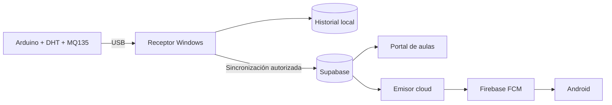
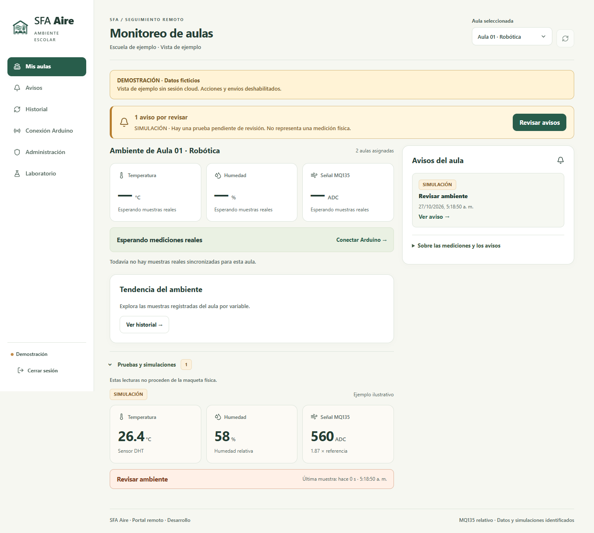

# SFA Aire

Proyecto escolar de monitoreo ambiental que conecta una maqueta Arduino con un
panel de aulas y avisos push en Android.

[Windows portable](https://github.com/hfreedo/SFA-Aire-Portal/releases/latest) ·
[Android 0.7.3](https://github.com/hfreedo/SFA-Aire-Portal/releases/tag/android-v0.7.3) ·
[Abrir el portal](https://sfa-aire-aulas.web.app/remoto) ·
[Guía de uso](docs/GUIA_PUBLICA.md)

## Del sensor al aviso

El Arduino envía por USB temperatura, humedad y señal MQ135 a una PC. El receptor
compara las lecturas con los umbrales configurados y exige que la variación se
mantenga antes de generar un aviso. El panel muestra el estado del aula y la nube
distribuye la notificación a los teléfonos registrados y autorizados.

- **Mediciones claras:** DHT para temperatura y humedad; MQ135 como señal relativa,
  sin convertirla en CO₂, AQI ni ppm.
- **Pruebas identificadas:** el laboratorio permite simular escenarios y comprobar
  avisos; las simulaciones y las lecturas vencidas se distinguen de los datos reales.
- **Acceso por aula:** el administrador invita personas y asigna permisos. Cada
  persona entra con su cuenta y registra su celular para recibir notificaciones.
- **Atención sencilla:** marcar un aviso como atendido no modifica la medición.
  Comunicarse con otra persona es opcional.

La PC debe permanecer encendida para adquirir nuevas muestras del Arduino.
Consultar el portal y entregar avisos ya encolados utiliza la nube. El sistema
conserva los límites preventivos de Supabase Free y Firebase Spark.

*Vista de ejemplo: las lecturas y el aviso mostrados son simulados.*

## Empezar

**Windows 10/11 x64:** descarga el ZIP portable de [Releases](https://github.com/hfreedo/SFA-Aire-Portal/releases/latest),
extrae la carpeta completa y abre **Panel SFA Aire.exe**. No requiere instalar
Python ni Node.js. **Abrir SFA Aire** inicia el servidor; al salir se puede
conservar el monitoreo o detenerlo. Windows 0.7.3 incluye Android piloto 0.7.2. Para medir: inicia sesión, selecciona el aula y abre
**Conexión Arduino**; la primera vinculación genera una credencial propia de esa PC.
La demostración sin cuenta utiliza datos ficticios y no envía notificaciones.

**Android 8 o posterior con Google Play Services:** instala la [APK piloto 0.7.3](https://github.com/hfreedo/SFA-Aire-Portal/releases/tag/android-v0.7.3),
entra con una cuenta invitada y registra las notificaciones desde **Ajustes**.
La versión 0.7.3 compacta el monitoreo, aclara las lecturas históricas y añade transiciones suaves.
El alta de la cuenta no registra automáticamente el teléfono. Las invitaciones
actuales se comparten mediante enlace privado o QR; no se envían correos automáticos.

El paquete empieza sin sesiones, bases de mediciones ni credenciales privadas.
Los datos nuevos se guardan en la carpeta de esa instalación. Consulta
[instalación, privacidad y verificación](docs/GUIA_PUBLICA.md) antes de compartirla.

## Alcance de la entrega

Prototipo escolar integrado. Los builds y las pruebas de lógica, permisos y
empaquetado se documentan en [la guía](docs/GUIA_PUBLICA.md#validación).
La comprobación física con sensores, el alta de otra persona y la prueba de
la APK piloto 0.7.2 en el Samsung se mantienen como verificaciones separadas.

## Autoría y condiciones

El código se publica para consulta y estudio; su disponibilidad no lo convierte
en software de licencia libre. Consulta [autoría](AUTORIA.md) y
[uso restringido](LICENCIA_DE_USO_RESTRINGIDO.md). Las dependencias conservan
sus propias licencias.

**Finalidad educativa:** no es un medidor certificado ni sustituye la evaluación
profesional del ambiente, la supervisión humana o los servicios de emergencia.
