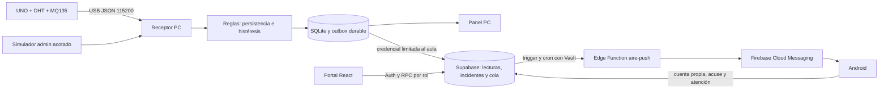

# Arquitectura base — SFA Aire v0.6.1 / entrega v0.6.2

La reorganización de código en curso se registra en [AUDITORIA_ARQUITECTURA.md](AUDITORIA_ARQUITECTURA.md).
Ese documento distingue componentes ya extraídos, pruebas y pendientes; las rutas
serial, API y RPC descritas aquí se conservan.

Proyecto independiente. La referencia de SFA anticaídas es tecnológica y visual;
no se copian sus secretos, cuentas, bases o identificadores cloud.

## Adquisición, decisión y persistencia

La maqueta actual usa UNO con DHT11 en D2 y MQ135 AO en A0. El sketch selecciona DHT11 por defecto; DHT22 se conserva como variante explícita mediante DHT_TYPE.
Solo comienza transmisión con MONITOR; PARAR la detiene. Serial y JSON no cambian.
La PC no mezcla fuentes; muestra datos vencidos, conserva detalle SQLite y sincroniza
normalmente cada minuto, con transiciones y laboratorio inmediatos. Una outbox
ordenada conserva paquetes ante fallo de red. El simulador se autoriza por RPC admin.

El DHT mide temperatura/humedad. MQ135 es señal ADC relativa a referencia
experimental: no se convierte a CO₂, AQI o ppm. Persistencia e histéresis filtran
oscilaciones. Un incidente conserva prioridad y requiere atención explícita.
Recuperar lectura, recibir aviso, abrirlo, comprender y ejecutar son hechos distintos.

## Firmware temporal de simulación USB — contrato serial v2

`arduino/SFA_Aire_Simulador_USB` funciona en UNO sin sensores. Agrega `serial_contract:2` y `simulated:true` a las tramas existentes. No transmite JSON hasta confirmar `SIMULACION_USB_V2`; el receptor actualizado responde al anuncio del sketch y después envía MONITOR. El firmware físico conserva v1 y sus pines.

Sin ensayo autorizado, la simulación USB es una vista previa en memoria. El botón «Probar en la app y enviar avisos · 3 min» autoriza por RPC un aire_lab_runs con input_source=usb, conserva el puerto y habilita el mismo recorrido de ingestión, reglas, SQLite/outbox, Supabase y FCM, con source=simulacion. Al finalizar vuelve a vista local. La APK existente es compatible. [Guía del ensayo completo](ENSAYO_USB_CLOUD_20261028.md).

Compilación UNO del firmware temporal: 4816 bytes flash, 304 RAM. El firmware se conserva; el receptor local y la función SQL están actualizados. Las pruebas físicas anteriores solo acreditan transmisión de datos ficticios por USB. El ensayo cloud completo con recepción real en celular requiere su propia evidencia. No se publicó un release ni se modificó la APK.

## Vista local en Mis aulas — 28/10/2026

En el portal de la PC, la cuenta administradora puede ver la muestra USB directa del aula asignada, consultada cada segundo sin escribir en nube. La tarjeta indica «En vivo · Esta PC». Se mantiene la fecha original, se vence tras 10 s sin trama y se aísla por aula, sesión, PC y fuente. El portal alojado y Android conservan la copia sincronizada. Ver [MI_AULA_LECTURA_LOCAL_20261028](MI_AULA_LECTURA_LOCAL_20261028.md).

## Referencia MQ135 por aula

El panel local añade captura experimental de muestras de firmware real, propuesta por mediana y aplicación explícita con revisión de reglas. El perfil activo y cinco versiones previas se conservan en SQLite por aula, con fecha y origen; no se generan escrituras cloud adicionales. Las simulaciones mantienen referencia de 300 ADC. [Ajuste y validación](CALIBRACION_MQ135_20261028.md).

## Acceso y atención sencilla — desarrollo 26/10/2026

Registro multi-PC (30/10/2026): alta inicial, asignación y capacidades comparten
la guarda de 10 PC habilitadas por aula. Cada instalación conserva identidad
propia y reintentos idempotentes. Un administrador puede volver a registrar
una PC retirada con una credencial nueva, sin reactivar la anterior ni mover
historial. Se conservan las cuotas de consumo globales. Ver
[REGISTRO_PC_MULTIPLES_20261030](REGISTRO_PC_MULTIPLES_20261030.md).

La prioridad es entregar la notificación y mostrar mediciones. La persona decide
qué hacer y cómo comunicarse. No se exige asignación de turno, coordinador,
instrucción, comprensión, resultado, código ni contacto para atender un aviso.
Docentes y administradores del aula pueden **Marcar atendido**, con nota opcional.
Observadores consultan; no se concede atención a otras aulas ni a anónimos.

El cierre es humano: resolver/resuelto se conservan como valores de transporte
para compatibilidad, con closure_kind=atendido, actor y fecha. Nunca fabrica
una lectura normal ni certifica la ejecución de una acción. Indicaciones antiguas
se retiran conservando el texto y las respuestas; no se marcan como realizadas.
La migración 20261026091353_simplify_alert_attention.sql reemplaza las condiciones
de cierre anteriores y las capacidades del overview. Se aplica después de la base
de receptores. Los clientes actuales muestran **Pendientes / Atendidos / Todos**.

Compartir es una acción manual que abre el selector nativo o copia texto para el
canal elegido. No crea una conversación cloud, no envía mensajes automáticamente,
no registra comprensión ni bloquea atención. Android ya no consulta
aire_coord_panel como requisito de actualización. Se conserva el historial
anterior en la base; el módulo de coordinación deja de formar parte del recorrido.
La atención v2 y capacidades están activadas en Supabase desde el 26/10/2026.
El emisor Firebase y contrato push conservan su versión desplegada anterior.

## Emisión cloud activada

Las seis migraciones conservan Auth/RLS, laboratorio, coordinación, reservas y
worker. Un trigger despierta aire-push; cron cada minuto recupera reintentos.
Vault protege cuenta de servicio Firebase y token privado del worker. Su endpoint
valida ese token por RPC concedido solo a service_role; no admite destinatarios
arbitrarios del body. Los RPC de PC no reclaman trabajos mientras cloud está activo.

Se revisan permisos, teléfono, consentimiento de simulación y vigencia antes de
reclamar. Hasta nueve trabajos por ejecución, lease de 120 s, cinco intentos y
vencimiento de cinco minutos; se prioriza Arduino. El ID de entrega estabiliza
la notificación Android ante duplicados de transporte. Los acuses van a Supabase.

La prueba v0.6 demostró FCM real, recibido y abierto en A02. La prueba v0.6.1
confirmó otro despacho y acuse mientras el servicio receptor estaba detenido,
con proceso ausente y sin listener en 8766. No se apagó Windows ni se cortó la
red del celular. La adquisición nueva sigue dependiendo de la PC.

## Alternativa LAN

El modo local conserva FastAPI, SQLite, clave compartida y emisor FCM opcional en
PC. Es una maqueta en red privada; no exponer el puerto directamente a internet.
Los acuses locales requieren alcanzar la PC. No confundir este recorrido con el
remoto, ya activado. Cada modo mantiene su ruta de acuse explícita.

## Economía y límites

Supabase Free y Firebase Spark, sin Billing. Reservas diarias 80/20 sin préstamo;
las omisiones quedan trazadas y no invalidan la medición. Guardas adicionales de
filas, tamaño, JSON, ensayos y 600 ejecuciones autenticadas/día y 10.000/mes del
worker. No son Usage del proveedor ni garantía de disponibilidad permanente.
El endpoint puede consumir cuota de plataforma al rechazar llamadas públicas.

## Experiencia y evidencia

React/TypeScript y Android Kotlin nativo comparten español, identidad verde,
prioridad de incidentes y separación de datos reales/simulados/vencidos. La app
abre cloud y conserva LAN como opción avanzada. La demostración local usa fixtures
marcados y sin red. Revisiones visuales en DISENO_Y_REVISION_V061.md.

Hardware y piloto humano siguen separados del cierre de software. Ver
CIERRE_V061_PLAN.md, VALIDACION.md y DEMO_Y_PILOTO.md.

## Contrato push v2 — activado el 26/10/2026

La entrega histórica 0.6.2 conserva su contrato anterior. La nube y APK 0.7.0
agregan `notification_contract=2` e `installation_id` al mensaje de datos FCM. Este último
es un identificador opaco del registro push de una sesión, no el user_id ni una clave.
Se obtiene de la instalación y generación local; se mantiene al renovar tokens y al
reiniciar el proceso, y cambia al cerrar sesión. El mismo valor se usa para registrar,
acusar y desvincular el teléfono. El registro nuevo usa aire_register_phone_v2 con
dispositivo estable y vínculo separados; el RPC v1 se conserva. Ambos autorizan en servidor.

Android valida contrato/vínculo e IDs antes del acuse y del aviso. Una publicación se
protege con la generación de sesión para que logout y publicación no puedan dejar un
aviso de la sesión cerrada. El PendingIntent lleva generación/vínculo y una URI propia;
abrirlo tras cambiar de sesión no selecciona el aula ni atribuye el acuse a otra cuenta.
La cola `cloud2@generación` no reasigna acuses de contratos antiguos. LAN conserva su
formato y solo se reciben avisos de la ruta push elegida.

Orden aplicado para 0.7.0: migración
`20261025195629_bind_push_to_session.sql`, después
`20261025200720_harden_phone_lifecycle.sql`, emisor Edge/PC v2 y después APK nueva con
registro del teléfono confirmado en Ajustes. Los clientes 0.6.2 ignoran los campos nuevos.
La APK nueva rechaza mensajes cloud sin vínculo v2; distribuirla antes del emisor impediría
mostrar sus avisos. El receptor PC de desarrollo también requiere la migración nueva
para su transporte cloud desde PC. La activación está completada; todavía falta una
prueba FCM real con la APK 0.7.0 en el A02. Se conserva el serial y los RPC anteriores.
Se agrega registro v2 y se amplía el cupo propio a veinte registros por aula / dos
por persona, sin cambiar los presupuestos diarios ni los planes. Revisión detallada: [AUDITORIA_RPC](AUDITORIA_RPC.md).

## Entrada Android de desarrollo

La única Activity exportada es LauncherActivity. Solo abre el espacio cloud normal con
un Intent nuevo; parámetros externos de entrega, aula o modo se descartan. CloudActivity
y MainActivity (LAN) son internas. LAN se abre desde el control Conexión local avanzada
en el acceso o Ajustes; las aperturas de notificación usan PendingIntent propio inmutable.
Esto conserva apertura legítima y elimina el uso de la entrada pública para generar acuses.
La APK 0.7.0 ya está preparada; evidencia en ANDROID_070 y VERIFICACION_ANDROID_070.json.

## Portal unificado y control local (26/10/2026)

El portal remoto incluye Administración por aula, Personas y Conexión Arduino.
POST /api/workspace/local recibe un JWT de la sesión y verifica en Supabase la
administración de esa aula y la PC habilitada. No confunde el JWT con la clave
local del receptor. La selección de aula no cambia el vínculo físico del receptor.
La lectura de estado cachea la autorización positiva veinte segundos; conectar,
detener y guardar reglas siempre vuelven a verificar. El control serial conserva
MONITOR/PARAR a 115200 y /api/serial/connect sigue disponible para clientes locales.
Las reglas tienen revisión persistida para evitar que otra sesión las sobrescriba.

El panel identifica su instalación por /health y solicita cierre ordenado en
/api/maintenance/shutdown con la clave local e instance_id, exclusivamente desde
loopback. El servidor termina su ciclo de vida y conserva SQLite; otras carpetas
que ocupan puertos vecinos no se detienen. La guía está en docs/GUIA_USO.html.

## Prueba de notificación sin receptor (26/10/2026)

Laboratorio inicia con la prueba cloud manual; el simulador PC queda en Avanzado.
Los RPC comprueban admin por aula y usan únicamente teléfonos autorizados con
consentimiento. Un origen kind=cloud_test separado evita tocar identidad, contacto,
credenciales o secuencia de las PC. Las capacidades y cupos físicos filtran kind=pc.
Las solicitudes idempotentes crean prueba, medición sintética, incidente y entregas
en una transacción y conservan las reservas gratuitas; no hay envío parcial por
presupuesto insuficiente. El emisor v3 identifica el mensaje como prueba manual.
Detalles de contratos, límites y evidencia en NOTIFICACIONES_SIMPLES.md.

### Asignación directa de la PC

El portal administra la asignación desde Conexión Arduino mediante /api/workspace/local (assignment/assign). El backend verifica la sesión admin y la RPC aire_assign_pc vuelve a autorizar tanto el aula anterior como el destino. La configuración persiste localmente sin exponer secretos; el cambio serializa la sincronización cloud y exige fuente detenida y cola vacía. Los incidentes SQLite conservan cloud_gateway_id para impedir que un cambio de aula reenvíe historial al destino. Véase docs/CONEXION_ARDUINO.md.
