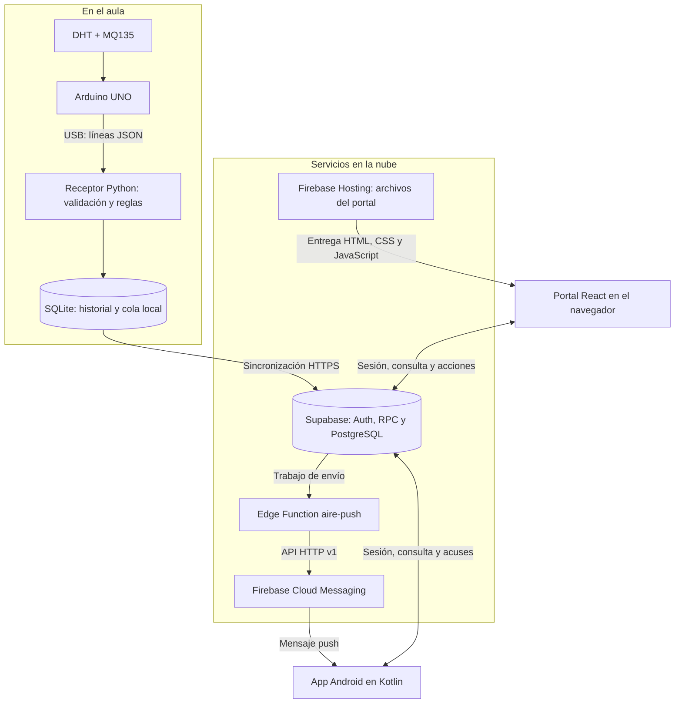
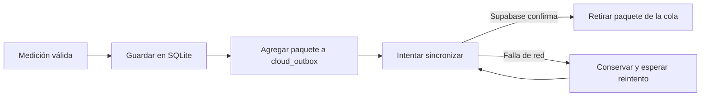
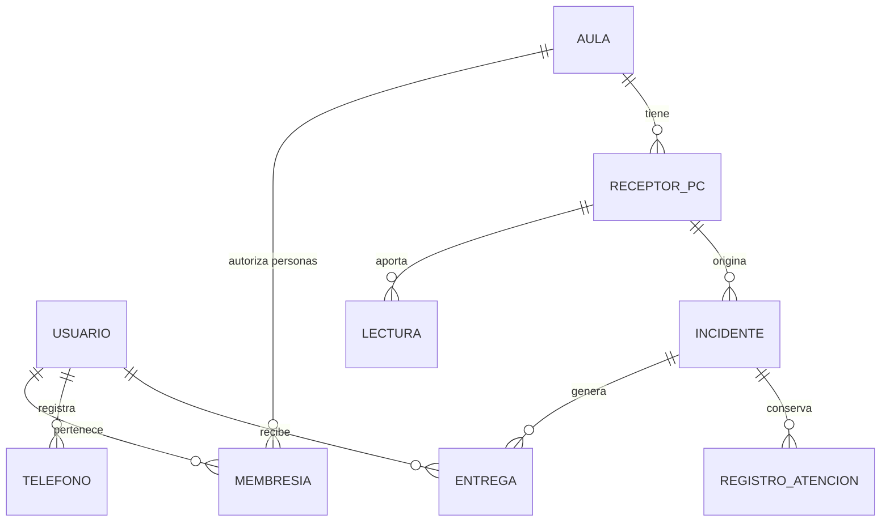
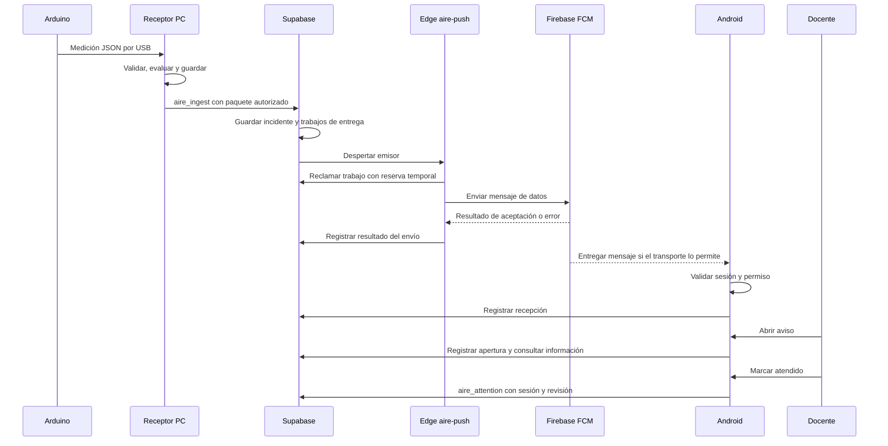

# Guía del stack tecnológico de SFA Aire

**Una referencia para estudiar el proyecto y explicar cómo funciona.**

Revisión del código: **27 de octubre de 2026**. Esta guía describe las tecnologías presentes en el repositorio. Las versiones exactas de cada componente se consultan en sus archivos de dependencias; el portal, el servidor y Android pueden tener números de versión diferentes.

No hace falta conocer todas las herramientas para empezar. Conviene leer primero el recorrido general, seguir una medición y después volver a los ejemplos de código.

## Contenido

1. [Qué construimos y qué significa «stack»](#1-qué-construimos-y-qué-significa-stack)
2. [Mapa del sistema](#2-mapa-del-sistema)
3. [Lenguajes, herramientas y entornos](#3-lenguajes-herramientas-y-entornos)
4. [Arduino: obtener las mediciones](#4-arduino-obtener-las-mediciones)
5. [Python: recibir, validar y decidir](#5-python-recibir-validar-y-decidir)
6. [SQLite: conservar el trabajo en la PC](#6-sqlite-conservar-el-trabajo-en-la-pc)
7. [React y TypeScript: mostrar el sistema en la web](#7-react-y-typescript-mostrar-el-sistema-en-la-web)
8. [Supabase: datos, cuentas y permisos](#8-supabase-datos-cuentas-y-permisos)
9. [Firebase: publicar el portal y transportar avisos](#9-firebase-publicar-el-portal-y-transportar-avisos)
10. [Android: consultar y recibir notificaciones](#10-android-consultar-y-recibir-notificaciones)
11. [Cómo se comunican las partes](#11-cómo-se-comunican-las-partes)
12. [Una situación completa, paso a paso](#12-una-situación-completa-paso-a-paso)
13. [Seguridad, consumo y límites](#13-seguridad-consumo-y-límites)
14. [Cómo recorrer el código y comprobar lo aprendido](#14-cómo-recorrer-el-código-y-comprobar-lo-aprendido)
15. [Guion para explicar el proyecto](#15-guion-para-explicar-el-proyecto)
16. [Glosario y referencias](#16-glosario-y-referencias)

## 1. Qué construimos y qué significa «stack»

SFA Aire es un prototipo para observar condiciones ambientales en aulas, registrar cambios y avisar a personas autorizadas. Combina sensores, una computadora, servicios en la nube, un portal web y una aplicación Android.

El **stack tecnológico** es ese conjunto de tecnologías y la forma en que colaboran. No es solamente una lista de lenguajes: también incluye dónde se ejecuta el código, cómo se guardan los datos y cómo viajan entre equipos.

Estas palabras aparecen con frecuencia:

| Concepto | Qué significa | Ejemplo del proyecto |
| --- | --- | --- |
| Lenguaje | Forma de escribir instrucciones | Python, TypeScript, Kotlin, SQL y C++ para Arduino |
| Librería | Código reutilizable para una tarea | `pyserial` abre el puerto USB; `DHT.h` permite leer el DHT |
| Framework | Estructura para construir una aplicación | FastAPI organiza el servicio HTTP de la PC |
| Entorno de ejecución | Programa o plataforma que ejecuta el código | Python en Windows, JavaScript en el navegador, Deno en las Edge Functions |
| IDE o editor | Herramienta para escribir, ejecutar y depurar | Arduino IDE, Android Studio o un editor como VS Code |
| Plataforma | Servicio que reúne capacidades | Supabase y Firebase |
| API | Interfaz por la que un programa solicita algo a otro | Pedir el historial o registrar la recepción de un aviso |
| SDK | Conjunto de herramientas de una plataforma para programar con ella | SDK Firebase Messaging en Android |

Un IDE ayuda a desarrollar; no es el sistema que usa el docente. Por ejemplo, Android Studio construye la APK, pero el celular ejecuta la aplicación sin necesitar Android Studio.

## 2. Mapa del sistema

El recorrido principal es **Arduino → PC → Supabase → Firebase FCM → Android**. El portal y Android también consultan Supabase para mostrar datos y registrar acciones.



En el dibujo, las flechas de consulta hacia la base representan llamadas a la API de Supabase. El navegador y el celular **no abren una conexión SQL directa** a PostgreSQL.

Hay tres recorridos que conviene distinguir:

| Recorrido | Para qué sirve | Dependencias |
| --- | --- | --- |
| Remoto | Consultar aulas y recibir avisos fuera de la red escolar | Supabase, internet y FCM para el push |
| Local o LAN | Trabajar con el receptor mediante su API local | PC encendida y red privada para clientes de otros equipos; FCM sigue siendo necesario si se usa push |
| Demostración sin cuenta | Explorar pantallas con datos ficticios | Datos de demostración del cliente; no prueba sensores ni envía notificaciones |

La PC es el **puente de adquisición**: el UNO de este montaje entrega datos por USB, no por Wi-Fi. Si la PC se apaga, deja de adquirir nuevas mediciones. Un aviso ya guardado en la cola cloud puede continuar su envío sin ese receptor, porque el emisor se ejecuta en Supabase.

## 3. Lenguajes, herramientas y entornos

### Qué se usa en cada parte

| Parte | Tecnología principal | Dónde se ejecuta | Archivos de referencia |
| --- | --- | --- | --- |
| Firmware | C++ y entorno Arduino, librería DHT | Microcontrolador UNO | [Sketch](../arduino/SFA_Aire_Aulas/SFA_Aire_Aulas.ino) |
| Receptor y API local | Python, FastAPI, Uvicorn, Pydantic, pyserial, httpx | PC Windows | [Dependencias Python](../servidor_pc/requirements.txt) |
| Persistencia local | SQLite, módulo `sqlite3` de Python | Archivo en la PC | [store.py](../servidor_pc/store.py) |
| Portal | React, TypeScript, HTML, CSS, Vite | Navegador; Node.js prepara el build | [package.json](../interfaz_web/package.json) |
| Datos y acceso remoto | Supabase Auth, PostgreSQL, funciones SQL y RLS | Supabase | [Migraciones](../supabase/migrations/) |
| Código cloud | TypeScript, Deno, `fetch` y Web Crypto | Supabase Edge Functions | [Funciones](../supabase/functions/) |
| Publicación web | Firebase Hosting | Infraestructura de Firebase | [firebase.json](../firebase.json) |
| Notificaciones | Firebase Cloud Messaging, API HTTP v1 y SDK Android | Emisor cloud y teléfono | [Emisor](../supabase/functions/aire-push/core.ts) |
| Aplicación móvil | Kotlin y vistas nativas de Android | Teléfono o emulador | [Proyecto Android](../android_app/) |
| Construcción Android | Gradle, Android Gradle Plugin, Android SDK, JDK | Equipo de desarrollo | [Configuración](../android_app/app/build.gradle.kts) |
| Lanzador Windows | Python, Tkinter/ttk y PyInstaller | PC Windows | [panel_inicio.py](../panel_inicio.py) |

### Con qué se puede trabajar

- **Arduino IDE** permite abrir el sketch, elegir UNO y usar el monitor serie. El repositorio también contempla `arduino-cli` para compilar desde terminal.
- **Android Studio** reúne editor, Android SDK, emulador y herramientas de depuración. El script del proyecto usa su JBR como Java si no hay otro configurado.
- **VS Code u otro editor** puede usarse para Python, React, SQL y Markdown. Es una opción de edición, no una dependencia obligatoria del producto.
- **PowerShell** permite ejecutar los scripts y las comprobaciones en Windows.
- **Consolas web de Supabase y Firebase** permiten administrar los servicios. No se incluyen dentro de la aplicación escolar.
- **Git** registra cambios de código; **GitHub** puede alojar ese repositorio. Alojar el código y alojar el portal son tareas distintas.

La preparación documentada para las fuentes utiliza **Python 3.13 y Node.js 24**. El proyecto Android apunta a bytecode Java/Kotlin 17 y declara `compileSdk = 35`, `targetSdk = 35` y `minSdk = 26`. Un SDK de compilación no es lo mismo que la versión de Android instalada en el teléfono.

Para reproducir dependencias se conservan `interfaz_web/package-lock.json` y `servidor_pc/requirements-lock.txt`. `npm ci` instala lo fijado en el lockfile. Que una tecnología publique una versión nueva no significa que el proyecto ya la esté usando.

## 4. Arduino: obtener las mediciones

El firmware se ocupa de leer sensores y producir un mensaje sencillo. Las decisiones de persistencia, incidentes y envío se realizan después, en la PC y la nube.

| Elemento | Conexión del sketch | Qué aporta |
| --- | --- | --- |
| DHT22, por defecto | DATA en D2 | Temperatura en °C y humedad relativa en % |
| DHT11, variante explícita | DATA en D2, cambiando `DHT_TYPE` | La misma clase de variables, con las características de ese sensor |
| Módulo MQ135 | Salida analógica AO en A0 | Lectura ADC relativa entre 0 y 1023 |
| USB | Puerto serie a 115200 baudios | Comunicación con la PC |

El montaje y su alimentación se explican en [HARDWARE.md](HARDWARE.md). Aquí interesa entender la función de cada pieza.

### La librería evita programar el protocolo del DHT desde cero

Fragmento real del [sketch](../arduino/SFA_Aire_Aulas/SFA_Aire_Aulas.ino):

```cpp
#include <DHT.h>
#ifndef DHT_TYPE
#define DHT_TYPE DHT22
#endif
const byte PIN_DHT = 2;
const byte PIN_MQ = A0;
DHT dht(PIN_DHT, DHT_TYPE);
```

`#include` incorpora la librería. `DHT_TYPE` selecciona el modelo y `dht` representa el sensor que el programa consultará. La lectura analógica del MQ135 usa `analogRead`, del entorno Arduino.

El sketch promedia ocho lecturas del MQ135 y consulta el DHT:

```cpp
long suma = 0;
for (byte i = 0; i < 8; i++) suma += analogRead(PIN_MQ);
int mq = suma / 8;
float humedad = dht.readHumidity();
float temperatura = dht.readTemperature();
```

Promediar reduce pequeñas fluctuaciones; no convierte la señal en una concentración de gas ni calibra el sensor.

### Qué sale por USB

Esta trama es un **ejemplo de datos**, con los mismos campos del contrato:

```json
{"device_id":"aula-01","mq_raw":335,"temperature":25.1,"humidity":54.2,"dht_ok":true,"warmed_up":true}
```

JSON expresa pares de nombre y valor. `mq_raw` es el ADC; `dht_ok` informa si la lectura DHT es válida. Ante un fallo DHT, temperatura y humedad llegan como `null`, no como cero inventado. `warmed_up` representa el temporizador inicial; no demuestra que el MQ135 esté acondicionado o calibrado.

El operador puede enviar `LEER` para una muestra, `MONITOR` para comenzar una cada tres segundos y `PARAR` para detener. Se usa final de línea **Nueva línea**. Al encender, Arduino no inicia por sí solo una transmisión periódica. Al conectar desde el sistema, el receptor envía `MONITOR`.

**El MQ135 de este proyecto no entrega CO₂, AQI ni ppm.** Se utiliza como señal relativa multisensible. Tampoco el estado «normal» certifica que el aire sea saludable.

## 5. Python: recibir, validar y decidir

Python hace de enlace entre el hardware y los servicios. La carpeta [servidor_pc](../servidor_pc/) divide las responsabilidades:

| Módulo | Responsabilidad |
| --- | --- |
| `main.py` | Estado de ejecución, recepción y API local |
| `workspace.py` | Control local vinculado a la sesión y al aula |
| `models.py` | Formato y rangos admitidos |
| `engine.py` | Interpretación de lecturas y confirmación de cambios |
| `store.py` | Persistencia SQLite |
| `cloud.py` | Sincronización con Supabase y cola local |
| `lab.py` | Simulación de laboratorio acotada |
| `push.py` | Alternativa de envío desde PC |

### Las librerías principales

| Librería | Trabajo concreto |
| --- | --- |
| `pyserial` | Abre y lee el puerto COM del Arduino |
| `Pydantic` | Comprueba tipos, rangos y coherencia de los datos |
| `FastAPI` | Define rutas HTTP y su documentación interactiva |
| `Uvicorn` | Ejecuta la aplicación FastAPI como servidor ASGI |
| `httpx` | Realiza solicitudes HTTP, incluidas llamadas a Supabase |
| `firebase-admin` | Permite el envío FCM en la alternativa emisora de PC |
| `sqlite3` | Accede a SQLite; viene con Python |

FastAPI define qué responde el servidor; Uvicorn escucha las conexiones y ejecuta esa aplicación. Instalar uno no sustituye al otro.

### Validar antes de usar una medición

Extracto real de [models.py](../servidor_pc/models.py):

```python
class Sample(BaseModel):
    device_id: Literal['aula-01'] = 'aula-01'
    mq_raw: int = Field(ge=0, le=1023)
    temperature: float | None = Field(default=None, ge=-40, le=80, allow_inf_nan=False)
    humidity: float | None = Field(default=None, ge=0, le=100, allow_inf_nan=False)
    dht_ok: bool = True
    warmed_up: bool = False
```

`ge` y `le` significan «mayor o igual» y «menor o igual». La clase también tiene una validación que exige temperatura y humedad cuando `dht_ok` es verdadero. Así se evita que una trama incompleta se trate como una medición válida.

El receptor utiliza esa clase al leer el puerto. Extracto de [main.py](../servidor_pc/main.py):

```python
raw = self.serial.readline(1024).decode('utf-8').strip()
if raw.startswith('{'):
    self.ingest(Sample.model_validate_json(raw), 'arduino')
```

Las líneas informativas del firmware empiezan por `#`; las mediciones empiezan por `{`. `model_validate_json` interpreta y comprueba la trama antes de entregarla a `ingest`.

### Decidir sin reaccionar a cada pequeño salto

El motor de [engine.py](../servidor_pc/engine.py) compara la lectura con una referencia experimental:

```python
ratio = sample.mq_raw / rules.baseline if rules.baseline else None
```

Si la referencia fuese 300 ADC y la lectura 450 ADC, la relación sería `450 / 300 = 1,5`. Es una comparación relativa, no «1,5 ppm».

El motor contempla **persistencia** e **histéresis**. La persistencia exige que un cambio dure cierto tiempo; la histéresis evita alternar continuamente entre dos estados cuando la señal ronda el umbral. Los valores predeterminados incluyen 12 segundos para confirmar una subida y 20 para la recuperación, además de las condiciones de validez y referencia. Son parámetros del prototipo, no límites sanitarios.

La regla de temperatura existe, pero está desactivada por defecto para la operación real hasta configurarla. El laboratorio puede habilitarla temporalmente. La humedad se registra como contexto y no tiene una regla propia de alerta en este motor.

### Una ruta de la API local

Extracto real de [main.py](../servidor_pc/main.py):

```python
@app.get('/api/state', dependencies=[Depends(auth)])
def state():
    return rt.snapshot()
```

`GET /api/state` solicita el estado. `Depends(auth)` exige la autenticación local antes de devolverlo. La API incluye otras rutas para historial, puertos y control, además de `/ws` para WebSocket. FastAPI ofrece documentación en `/docs` cuando el servicio está en marcha.

El control integrado del portal local usa `/api/workspace/local` con la sesión Supabase y vuelve a comprobar permisos. **El JWT de esa sesión y la clave local del receptor son credenciales diferentes.**

## 6. SQLite: conservar el trabajo en la PC

SQLite es una base de datos que se guarda en un archivo. No requiere levantar un servidor de base de datos aparte. El receptor la utiliza para conservar muestras, incidentes, ajustes y trabajos pendientes.

En [store.py](../servidor_pc/store.py) se abre así:

```python
self.db = sqlite3.connect(path, check_same_thread=False)
self.db.row_factory = sqlite3.Row
self.db.execute('PRAGMA journal_mode=WAL')
```

`WAL` es un modo de registro de cambios de SQLite. El repositorio también usa bloqueos y transacciones para coordinar el acceso desde los distintos trabajos del receptor.

La tabla `cloud_outbox` funciona como una **bandeja de salida persistente**. Si hay un fallo de red, el paquete puede quedar pendiente para reintentarlo. Su secuencia ayuda a conservar el orden y reconocer paquetes ya procesados.



SQLite guarda el detalle local; PostgreSQL en Supabase conserva la información compartida. No son dos nombres para la misma base. La sincronización normal reduce el muestreo cloud aproximadamente a una muestra por minuto y adelanta las transiciones; no intenta publicar cada lectura USB continuamente. Hay límites de cola, retención y reintentos: no se promete recuperar indefinidamente toda muestra.

## 7. React y TypeScript: mostrar el sistema en la web

El portal vive en [interfaz_web](../interfaz_web/). Permite consultar mediciones, revisar avisos y realizar las acciones que autoriza el rol de cada persona.

- **HTML** aporta la estructura de la página.
- **CSS** define presentación, colores, tamaños, separación y adaptación a pantallas.
- **React** organiza la interfaz en componentes y actualiza lo mostrado cuando cambia el estado.
- **TypeScript** añade comprobaciones de tipos al código que finalmente se convierte en JavaScript.
- **Vite** sirve el entorno de desarrollo y prepara los archivos de producción.
- **Node.js y npm** ejecutan esas herramientas e instalan dependencias en el equipo de desarrollo.

El navegador ejecuta el JavaScript resultante; no necesita instalar Node.js para abrir el portal. Firebase Hosting sirve los archivos construidos, no ejecuta el receptor Python.

### Librerías y decisiones concretas

| Recurso | Uso comprobable en el código |
| --- | --- |
| `@supabase/supabase-js` | Sesión, llamadas RPC e invocación de Edge Functions |
| `lucide-react` | Iconos de la interfaz |
| `qrcode` | Generación del QR de invitación en el cliente |
| React y React DOM | Componentes y montaje de la página |
| SVG | Gráficos de mediciones construidos en el propio proyecto |

El gráfico [MeasurementChart.tsx](../interfaz_web/src/shared/MeasurementChart.tsx) dibuja sus líneas con SVG y permite explorar puntos. No requiere atribuirle una librería de gráficos externa. El QR web tampoco depende de enviar la invitación a un servicio público de imágenes.

### Cómo se crea el cliente de Supabase

Extracto de [data/cloud/client.ts](../interfaz_web/src/data/cloud/client.ts), con formato expandido para lectura:

```typescript
export function cloudClient(url: string, key: string) {
  const config = publicConfig(url, key);
  return createClient(config.url, config.key, {
    auth: {
      persistSession: true,
      storage: sessionStorage,
      storageKey: cloudStorageKey(config.url),
      autoRefreshToken: true,
      detectSessionInUrl: false
    }
  });
}
```

`publicConfig` valida la URL y rechaza claves secretas. `sessionStorage` conserva la sesión en el almacenamiento de esa pestaña. La sesión y las solicitudes se controlan en [CloudSession.ts](../interfaz_web/src/application/session/CloudSession.ts) y su adaptador [sessionPort.ts](../interfaz_web/src/data/cloud/sessionPort.ts), para evitar aplicar respuestas a una identidad que ya cambió.

Este es un **ejemplo didáctico reducido** del tipo de consulta que realiza el adaptador; no sustituye sus controles de sesión:

```typescript
const { data, error } = await client.rpc('aire_overview');
if (error) throw error;
// data contiene la vista general permitida para esta cuenta.
```

`await` espera la respuesta. `rpc` pide ejecutar una función del servidor. La interfaz no obtiene permisos adicionales por conocer su nombre.

La consulta remota normal se actualiza periódicamente, aproximadamente cada 60 segundos mientras la pantalla está visible. **La implementación no depende de suscripciones de Supabase Realtime para este recorrido.** Que una plataforma ofrezca Realtime no significa que todos sus proyectos lo usen.

## 8. Supabase: datos, cuentas y permisos

Supabase reúne varios servicios. En SFA Aire tiene el papel de **backend compartido**: conserva el estado remoto, identifica usuarios y controla qué operaciones puede realizar cada uno.

| Servicio o recurso | Papel en SFA Aire |
| --- | --- |
| PostgreSQL | Guarda aulas, membresías, lecturas, incidentes, entregas y auditoría |
| Auth | Inicia sesiones y proporciona la identidad de la cuenta |
| Data API y RPC | Permiten consultar y ejecutar funciones mediante HTTPS |
| RLS | Filtra el acceso a filas según las políticas de la base |
| Funciones SQL/PLpgSQL | Validan acciones, permisos, revisiones, cuotas y transiciones |
| Edge Functions | Ejecutan código cloud para push, cuentas e invitaciones |
| Vault | Protege secretos usados por el emisor cloud |
| Triggers, cron y solicitudes HTTP con `pg_net` | Despiertan el emisor y recuperan trabajos pendientes |

Las Edge Functions ejecutan TypeScript en un entorno basado en Deno; pueden llamar a servicios HTTP. No son funciones que se ejecuten dentro del navegador. [Referencia oficial de Edge Functions](https://supabase.com/docs/guides/functions).

### Cómo se organizan los datos

Este esquema es **una selección simplificada de relaciones**, no un reemplazo del esquema SQL completo:



Los nombres reales incluyen `aire_classrooms`, `aire_members`, `aire_gateways`, `aire_readings`, `aire_incidents`, `aire_deliveries`, `aire_attention_log` y `aire_phones`. `aire_snapshots` conserva la última observación por receptor y fuente para las consultas de estado.

No se duplican todos los campos en cada tabla. Por ejemplo, una lectura referencia el aula y el receptor mediante identificadores. Un incidente puede generar varias entregas si hay varias personas o teléfonos destinatarios.

### Auth y RLS responden preguntas diferentes

**Auth** responde «¿quién es esta persona?». La **autorización** responde «¿puede consultar o modificar esta aula?». Una cuenta válida no tiene acceso automático a todas las aulas.

Extracto real de la [migración inicial](../supabase/migrations/202610240001_aire_cloud.sql), con formato expandido:

```sql
alter table public.aire_readings enable row level security;

create policy readings_read on public.aire_readings
for select to authenticated
using (public.aire_role(classroom_id) is not null);
```

La política permite leer filas a cuentas autenticadas que tengan un rol en el aula correspondiente. También existen permisos SQL y comprobaciones dentro de las RPC; RLS es una capa de la protección, no toda la seguridad. [Referencia oficial de RLS](https://supabase.com/docs/guides/database/postgres/row-level-security).

Algunas funciones del proyecto utilizan `security definer` para operaciones controladas. Por eso revisan explícitamente identidad, aula y rol, y restringen quién puede invocarlas. No debe copiarse esa cláusula como una forma de saltar errores de permisos.

### RPC: operaciones con nombre y reglas en el servidor

| RPC o familia | Para qué se utiliza |
| --- | --- |
| `aire_overview` | Consulta general de aulas, observaciones e incidentes permitidos |
| `aire_history` | Historial por aula y fuente |
| `aire_ingest` | Ingreso de paquetes de un receptor autorizado |
| `aire_attention` | Registro de atención humana |
| `aire_register_phone_v2` | Registro del teléfono y vínculo con su sesión |
| `aire_receipt` | Acuse de recepción o apertura |
| RPC de laboratorio | Preparación y control de ensayos con autorización admin |
| `aire_cloud_*` | Apertura, reserva y resultado de trabajos del emisor cloud |

Ejemplo didáctico de la forma HTTP de una consulta sin parámetros:

```http
POST https://PROYECTO.supabase.co/rest/v1/rpc/aire_overview
apikey: CLAVE_PUBLICA_DEL_PROYECTO
Authorization: Bearer JWT_DE_LA_SESION
Content-Type: application/json

{}
```

Los nombres en mayúscula son marcadores de posición, no credenciales reales. El cliente web usa el SDK para preparar esta comunicación; Python usa `httpx` y Android realiza solicitudes HTTP JSON. No se necesita el SDK Supabase en cada lenguaje para usar la misma API.

### Las tres Edge Functions del repositorio

- [aire-push](../supabase/functions/aire-push/): toma trabajos autorizados de la cola y llama a FCM.
- [aire-members](../supabase/functions/aire-members/): gestión de cuentas y vínculo de personas con aulas, tras verificar permisos.
- [aire-invitations](../supabase/functions/aire-invitations/): operaciones de invitación con enlace privado y autorización en servidor.

Las invitaciones actuales generan enlace/QR para compartir manualmente. **Generar ese enlace no envía un correo automáticamente.** No se debe describir un servicio SMTP contratado que el proyecto no utiliza.

### Migraciones: historia ordenada de la base

Los archivos de [supabase/migrations](../supabase/migrations/) crean y modifican tablas, funciones y políticas. Las migraciones posteriores pueden reemplazar funciones anteriores; por eso no alcanza con leer el primer archivo para explicar el comportamiento actual.

Por ejemplo, la atención actual permite que un docente o administrador marque un aviso como atendido con nota opcional. Se conservan los valores de transporte `resolver` y `resuelto` por compatibilidad; no significan que el sensor haya vuelto a un valor normal. La coordinación antigua permanece como antecedente y no es un requisito del recorrido principal.

Esta guía es informativa: **no hace falta ejecutar migraciones para estudiarla**. Tampoco se deben reaplicar todas sobre una base que ya está en uso.

## 9. Firebase: publicar el portal y transportar avisos

Firebase cumple **dos funciones distintas** en este proyecto:

| Servicio | Qué hace | Qué no hace en SFA Aire |
| --- | --- | --- |
| Firebase Hosting | Sirve los archivos del portal por HTTPS | No guarda las mediciones ni ejecuta el receptor USB |
| Firebase Cloud Messaging, FCM | Transporta mensajes push al teléfono registrado | No decide los umbrales ni sustituye la base de incidentes |

Las cuentas escolares y los datos se administran en **Supabase**, no mediante Firebase Authentication o Firestore. El diseño actual tampoco necesita Cloud Functions de Firebase para enviar estos avisos: la función emisora está en Supabase.

### Hosting: dónde está publicado el portal

El navegador descarga HTML, CSS y JavaScript desde Hosting y después se comunica con Supabase usando la sesión de la persona. La configuración del repositorio dirige las rutas del sitio a `index.html`, de modo que una entrada como `/remoto` pueda abrir la aplicación.

Extracto reducido de [firebase.json](../firebase.json):

```json
{
  "hosting": {
    "public": "publication/hosting",
    "rewrites": [{"source": "**", "destination": "/index.html"}]
  }
}
```

El archivo real incluye cabeceras de seguridad y caché. Preparar el build y publicarlo son pasos diferentes: `npm run build` genera archivos locales; no publica por sí solo. Véase la [documentación de Hosting](https://firebase.google.com/docs/hosting).

El portal alojado no puede abrir el COM del Arduino mediante la API del servidor de Hosting. Esa conexión se realiza desde el panel instalado en la PC del aula.

### FCM: cómo llega el aviso

El emisor cloud autentica su llamada ante Google con una cuenta de servicio, obtiene un token de acceso OAuth 2.0 y llama a la **API HTTP v1 de FCM**. Ese token del emisor es diferente del token FCM que identifica el destino móvil.

Extracto de [aire-push/core.ts](../supabase/functions/aire-push/core.ts):

```typescript
const response = await fetch(
  `https://fcm.googleapis.com/v1/projects/${project}/messages:send`,
  {
    method: 'POST',
    signal: AbortSignal.timeout(8000),
    headers: {
      Authorization: 'Bearer ' + token,
      'Content-Type': 'application/json'
    },
    body: JSON.stringify(message(job))
  }
);
```

`message(job)` construye un mensaje de datos con destino y campos como `delivery_id`, `incident_id`, aula, fuente y vínculo de sesión. Android valida esos campos y construye la notificación visible. El SDK FCM y el servidor de confianza cumplen papeles diferentes en la [arquitectura oficial de FCM](https://firebase.google.com/docs/cloud-messaging/fcm-architecture).

La función no acepta un destinatario arbitrario enviado por quien llama: reclama trabajos autorizados de la base. El trigger la despierta y el cron recupera pendientes. Una reserva temporal, o *lease*, evita que dos ejecuciones procesen libremente el mismo trabajo; también existen vencimiento y reintentos acotados.

**«FCM aceptó» no equivale a «la persona lo leyó».** Hay que distinguir:

1. Se creó el trabajo de envío.
2. FCM aceptó el mensaje.
3. La app registró recepción.
4. La persona abrió la notificación.
5. Una persona autorizada marcó el aviso como atendido.

Permisos del sistema, conexión, sesión y estado del dispositivo pueden afectar el recorrido. No se promete un tiempo fijo de entrega ni reconocimiento en una fracción determinada de segundo.

## 10. Android: consultar y recibir notificaciones

La aplicación de [android_app](../android_app/) está escrita en **Kotlin**, con `Activity`, `View` y componentes nativos de `android.widget`. Las pantallas no son una web dentro de una WebView y la interfaz actual no está hecha con Jetpack Compose.

| Pieza | Papel |
| --- | --- |
| `LauncherActivity` | Entrada pública de la aplicación |
| `CloudActivity` | Espacio de acceso remoto y consulta |
| `MainActivity` | Recorrido local avanzado |
| `CloudApi` y `JsonTransport` | Comunicación HTTP JSON y llamadas a Supabase |
| `SessionRepository` | Gestión de sesión y su generación |
| `NotificationPolicy` | Validación del vínculo del mensaje con la sesión |
| `AireMessagingService` | Recepción FCM y construcción de notificaciones |
| `ui/screens` y `AireUi` | Pantallas y componentes visuales compartidos |

### Dónde se incorpora Firebase

Extracto real de [app/build.gradle.kts](../android_app/app/build.gradle.kts):

```kotlin
implementation(platform("com.google.firebase:firebase-bom:33.7.0"))
implementation("com.google.firebase:firebase-messaging")
```

La **BoM** alinea versiones de librerías Firebase compatibles entre sí. `firebase-messaging` aporta el servicio y las clases para registrar y recibir mensajes. Gradle descarga esas dependencias y construye la APK.

### El punto de entrada de un mensaje

Extracto real de [AireMessagingService.kt](../android_app/app/src/main/java/org/sfa/aire/AireMessagingService.kt):

```kotlin
class AireMessagingService : FirebaseMessagingService() {
    override fun onNewToken(token: String) {
        Api.prefs(this).edit().putString("fcm_token", token).apply()
        Thread { try { Api.register(this, token) } catch (_: Exception) {} }.start()
    }
    // La clase continúa con onMessageReceived y las validaciones del aviso.
}
```

`onNewToken` se ejecuta cuando FCM entrega o renueva un token. El registro lo vincula con la cuenta, el aula y la sesión correspondientes; no basta con guardar una cadena en el teléfono.

En `onMessageReceived`, el servicio verifica ruta, contrato y vínculo de sesión antes del acuse y de publicar el aviso. Usa `NotificationChannel`, `NotificationManager` y un `PendingIntent` para abrir la pantalla correspondiente. En Android 13 o superior también comprueba el permiso de notificaciones.

El contrato push v2 incluye `installation_id` como vínculo opaco de notificación; no es la contraseña ni el identificador del usuario. Los controles de sesión evitan atribuir un aviso a otra cuenta después de cerrar sesión. No conviene simplificar este código quitando sus comprobaciones.

## 11. Cómo se comunican las partes

La conexión física y el formato de datos no son lo mismo. USB es el medio entre UNO y PC; JSON es la forma de representar el contenido.

| Conexión | Medio y formato | Identidad o control |
| --- | --- | --- |
| UNO → PC | USB serie, 115200, JSON por línea | Puerto y trama admitida |
| PC → Supabase | HTTPS, RPC y JSON | Configuración pública más secreto limitado del receptor |
| Portal → Supabase | HTTPS, SDK y JSON | Sesión de usuario, roles y permisos del aula |
| Android → Supabase | HTTPS, Auth y RPC JSON | Sesión y vínculo de notificación |
| Supabase → FCM | HTTPS, API HTTP v1, mensaje JSON | Cuenta de servicio y token OAuth del emisor |
| FCM → Android | Transporte push gestionado por FCM | Token de destino; la app verifica además contrato y sesión |
| Cliente LAN → PC | API HTTP local; WebSocket disponible | Clave local; control integrado con sesión usa su ruta específica |

La API local y la API de Supabase son interfaces diferentes. `/api/state` pertenece al receptor Python; `/rest/v1/rpc/aire_overview` pertenece a Supabase. Se parecen porque ambas intercambian JSON, pero tienen responsabilidades y credenciales distintas.

Las pantallas consultan datos periódicamente; el push avisa de un evento. Son mecanismos complementarios. Una notificación no sustituye al historial ni mantiene por sí sola todas las lecturas actualizadas.

## 12. Una situación completa, paso a paso

Imaginemos un aula con el hardware conectado, una referencia experimental configurada, una cuenta docente autorizada y un teléfono registrado.

1. Arduino obtiene una lectura y la escribe por USB.
2. Python valida la trama. El motor evalúa la señal y espera la persistencia necesaria si aparece una variación.
3. Se conserva el registro local. Si se confirma el cambio, se crea o actualiza el incidente y se prepara la sincronización.
4. Supabase comprueba la identidad del receptor y acepta el paquete. Guarda datos y prepara las entregas permitidas por destinatarios y guardas.
5. `aire-push` toma un trabajo y llama a FCM. Guarda el resultado del proveedor.
6. Android recibe el mensaje, valida su sesión, registra el acuse y muestra la notificación si los permisos lo permiten.
7. Al abrirla, la app consulta información autorizada. El docente puede marcar el aviso como atendido con una nota opcional.



**Medición, incidente, entrega y atención son cosas distintas.** El ambiente puede cambiar sin que una persona atienda el incidente; una persona puede atenderlo sin que eso fabrique una medición normal. La migración posterior de preservación de entregas mantiene separados el cierre humano y el envío de la alerta ambiental.

Para estudiar sin hardware, el proyecto ofrece una demostración de pantallas y ensayos administrativos. El laboratorio de PC recorre el motor con datos sintéticos. La prueba manual cloud puede generar un aviso de prueba sin Arduino ni receptor. Cada una demuestra un tramo diferente y debe identificarse como simulación.

## 13. Seguridad, consumo y límites

### Cada credencial tiene un papel

| Dato | Dónde corresponde | Qué significa |
| --- | --- | --- |
| URL y clave pública Supabase | Web y Android; configuración pública del receptor | Identifican el proyecto, no conceden acceso administrativo |
| Contraseña y tokens de sesión | Gestión de sesión de cada cliente | Identifican a la persona; no van a Git ni a ejemplos |
| Secreto limitado de receptor | Configuración privada de esa PC | Autoriza el ingreso y control de su receptor |
| Clave `service_role` | Código cloud con privilegios | No se distribuye al navegador ni al APK ni al receptor ordinario |
| Cuenta de servicio Firebase | Vault en el recorrido cloud; configuración privada si se usa el emisor PC | Autoriza al emisor ante Google |
| Token FCM de destino | Registro privado del teléfono | Permite dirigir mensajes; no debe publicarse en consultas o capturas |

El archivo `google-services.json` configura el cliente Firebase Android; no es una cuenta de servicio emisora. El repositorio maneja su preparación por separado. No se incluyen claves privadas, sesiones, bases reales ni archivos privados en los ejemplos de esta guía.

Ocultar un botón no autoriza una operación. Un usuario podría intentar llamar a la API directamente; por eso el laboratorio vuelve a comprobar el rol **admin en RPC** y las acciones de aula se validan en servidor.

### Política de planes y consumo

El proyecto conserva **Supabase Free y Firebase Spark, sin vincular Billing**. No necesita contratar servicios para seguir esta guía. Las cuotas del proveedor pueden cambiar; sus consolas y documentación son la referencia para verificarlas.

Además, la aplicación tiene guardas propias: reducción de muestras cloud, reservas diarias separadas de **80 entregas operativas y 20 de simulación**, límites de almacenamiento, respuestas, ensayos y ejecuciones del emisor. Son decisiones internas del proyecto, no la cuota oficial de los proveedores ni una garantía de disponibilidad ilimitada.

Si una guarda o una interrupción detiene el recorrido remoto, la pantalla debe mostrarlo. Conservar datos locales no garantiza que un aviso llegue al teléfono mientras no hay conexión.

### Hasta dónde llegan las comprobaciones

- Una compilación correcta confirma que se pudo construir el programa.
- Una prueba con transporte FCM sustituido comprueba lógica, no un envío real.
- Una aceptación FCM confirma al proveedor, no recepción humana.
- Una recepción física comprobada corresponde al teléfono y versión ensayados.
- El montaje y la validación experimental del sensor requieren pruebas propias.

El repositorio conserva evidencia histórica de push real en un Samsung A02. Eso no valida automáticamente el hardware ni todas las APK posteriores; el README distingue la entrega Android actual de sus pendientes físicos. Esta revisión documental no ejecutó una nueva prueba cloud o de dispositivo.

## 14. Cómo recorrer el código y comprobar lo aprendido

### Un orden de estudio que permite seguir una medición

1. Leer esta guía y [ARQUITECTURA.md](ARQUITECTURA.md) para ubicar cada parte.
2. Abrir el sketch y localizar `muestra`, `MONITOR` y `PARAR`.
3. Buscar `Sample` en `models.py` y `evaluate` en `engine.py`.
4. Localizar `cloud_outbox` en `store.py` y `aire_ingest` en `cloud.py`.
5. Buscar `aire_readings`, `aire_incidents` y `aire_overview` en las migraciones; revisar también sus reemplazos posteriores.
6. Leer `data/cloud/client.ts` y `sessionPort.ts` para comprender el acceso web.
7. Abrir `aire-push/index.ts` y `core.ts` para seguir un envío.
8. Terminar en `CloudApi.kt` y `AireMessagingService.kt` para ver consulta, recepción y acuses.

Los ejemplos anteriores son extractos o reducciones indicadas. No son programas completos independientes: necesitan los imports, objetos y controles del archivo original.

### Herramientas de comprobación presentes

| Herramienta | Qué comprueba | Límite |
| --- | --- | --- |
| `unittest` de Python | Reglas, receptor, integración y otros recorridos locales | Los servicios sustituidos no acreditan nube real |
| PGlite | Migraciones y permisos sobre PostgreSQL local en WASM | Usa un entorno de prueba; no es la instancia alojada de Supabase |
| Pruebas de Node.js | Lógica de workers y otros módulos | Dependen de los escenarios definidos |
| TypeScript y Vite | Tipos y construcción del portal | No verifican por sí solos la apariencia o usabilidad |
| Gradle y JUnit | Construcción Android y pruebas de lógica | Construir APK no demuestra recepción en dispositivo |
| Revisiones de navegador, emulador y teléfono | Pantallas y comportamiento observado | Cada evidencia tiene su versión y alcance |

Estos comandos se ejecutan **desde la raíz del proyecto**, en un entorno preparado. Son una referencia de comprobación; no es necesario ejecutarlos para leer la guía:

```powershell
# Pruebas Python
.\.venv\Scripts\python.exe -m unittest discover -s tests

# Comprobaciones SQL locales y del worker
node herramientas/sql-check/verify.mjs
node herramientas/sql-check/cloud-checks.mjs
node --test herramientas/sql-check/worker.test.mjs

# Compilación para Arduino UNO; no carga el programa a la placa
arduino-cli compile --fqbn arduino:avr:uno arduino\SFA_Aire_Aulas

# Instalación reproducible de dependencias web y build local
npm --prefix interfaz_web ci
npm --prefix interfaz_web run build

# Construcción de la APK de depuración y copia a Entregas
.\compilar_android.ps1 -TcpLoopback
```

La preparación completa está en [GUIA_RAPIDA.md](GUIA_RAPIDA.md) y [CONEXION_ARDUINO.md](CONEXION_ARDUINO.md). `-TcpLoopback` es la adaptación del script para el problema JBR/AF_UNIX diagnosticado en este equipo. El script ejecuta `assembleDebug`; no publica la APK ni la instala automáticamente. Ningún comando de este bloque despliega Hosting o modifica migraciones cloud.

Para la distribución Windows se usa PyInstaller. Empaquetar reúne el programa y sus dependencias; no reemplaza una prueba desde una extracción limpia. Tkinter/ttk construye el lanzador, mientras el portal principal sigue siendo React en un navegador.

## 15. Guion para explicar el proyecto

Una explicación breve puede seguir este recorrido:

> «Arduino lee temperatura, humedad y una señal analógica del MQ135. Envía los datos por USB a una computadora. Allí, Python valida las lecturas, aplica reglas con persistencia y conserva un registro en SQLite. La PC sincroniza con Supabase, donde se guardan los datos y se controlan cuentas y permisos por aula. Si corresponde un aviso, una función en Supabase lo envía mediante Firebase Cloud Messaging. La aplicación Android lo recibe y registra sus acuses. El portal React permite consultar el sistema y está publicado en Firebase Hosting. Atender un aviso es una acción humana distinta de la medición ambiental».

Para comprobar que se comprendió, conviene poder responder:

| Pregunta | Idea que debe aparecer en la respuesta |
| --- | --- |
| ¿Por qué hay una PC entre Arduino y la nube? | El UNO entrega por USB; la PC valida, decide, guarda y sincroniza |
| ¿Por qué usamos SQLite y PostgreSQL? | Persistencia local y estado compartido remoto tienen funciones diferentes |
| ¿Supabase y Firebase hacen lo mismo? | Supabase guarda y autoriza; Firebase aloja el portal y transporta push |
| ¿Quién determina que una variación se confirmó? | El motor de reglas del receptor, con parámetros y condiciones válidas |
| ¿Puede funcionar todo con la PC apagada? | No hay adquisición nueva; una entrega cloud ya persistida puede continuar |
| ¿Qué demuestra una prueba simulada? | El tramo que recorre con datos ficticios, no el montaje físico |
| ¿MQ135 mide CO₂ en este sistema? | No; se presenta como ADC relativo |
| ¿Marcar atendido normaliza el ambiente? | No; registra una decisión humana sin modificar mediciones |
| ¿Por qué el acceso se comprueba en el servidor? | Un botón oculto no impide una llamada directa a la API |

## 16. Glosario y referencias

| Término | Significado en este proyecto |
| --- | --- |
| ADC | Conversión de una señal analógica a un número; aquí, de 0 a 1023 |
| Firmware | Programa que se carga en Arduino |
| Frontend | Parte visible con la que interactúa la persona |
| Backend | Código y servicios que procesan solicitudes y aplican reglas |
| JSON | Formato de datos con campos y valores |
| HTTP / HTTPS | Protocolo de solicitudes y respuestas; HTTPS protege el transporte con TLS |
| REST | Estilo de API basado en recursos y operaciones HTTP |
| RPC | Llamada a una función que se ejecuta en otro sistema |
| JWT | Token firmado que transporta información de sesión; el servidor debe validarlo |
| RLS | Políticas de seguridad por fila en PostgreSQL |
| Gateway o receptor | PC que conecta el montaje con el sistema remoto |
| Outbox | Cola persistente de paquetes pendientes de sincronización |
| Worker | Código que procesa trabajos de una cola |
| Cron | Programación periódica de tareas |
| Trigger | Acción que se dispara ante un evento de la base |
| Push | Mensaje enviado al dispositivo sin esperar una consulta de la pantalla |
| Acuse | Registro de recepción o apertura enviado por el cliente |
| Idempotencia | Reintentar una misma operación sin duplicar su efecto |
| APK | Archivo instalable de una aplicación Android |
| Build | Proceso que comprueba y transforma fuentes en archivos utilizables |
| Mermaid | Sintaxis de texto para diagramas, como los de esta guía |

### Documentación del proyecto

- [README](../README.md): entrega actual y límites de validación.
- [Arquitectura](ARQUITECTURA.md): recorridos, contratos y separación entre LAN y nube.
- [Protocolo](PROTOCOLO.md): campos serial/API y evolución de contratos; leer sus actualizaciones posteriores a las secciones históricas.
- [Hardware](HARDWARE.md): montaje, alimentación y límites del sensado.
- [Portal e invitaciones](PORTAL_PUBLICO_E_INVITACIONES.md): publicación estática, cuentas e invitaciones actuales.
- [Atención sencilla](ATENCION_SIMPLE.md): significado de «Marcar atendido».
- [Notificaciones simples](NOTIFICACIONES_SIMPLES.md): prueba manual cloud y sus evidencias.
- [Validación](VALIDACION.md): qué se comprobó y qué continúa pendiente.

### Referencias oficiales para ampliar

Estas referencias ayudan a estudiar conceptos. Los archivos del repositorio determinan cómo se usan aquí; la documentación externa puede describir funciones adicionales que SFA Aire no utiliza.

- [Arduino: referencia del lenguaje](https://docs.arduino.cc/language-reference/).
- [Python: tutorial](https://docs.python.org/es/3/tutorial/) y [SQLite desde Python](https://docs.python.org/3/library/sqlite3.html).
- [FastAPI: tutorial](https://fastapi.tiangolo.com/tutorial/).
- [Pydantic: modelos](https://docs.pydantic.dev/latest/concepts/models/).
- [React: aprender](https://react.dev/learn), [TypeScript: manual](https://www.typescriptlang.org/docs/handbook/intro.html) y [Vite: guía](https://vite.dev/guide/).
- [Supabase: Auth](https://supabase.com/docs/guides/auth), [RLS](https://supabase.com/docs/guides/database/postgres/row-level-security) y [Edge Functions](https://supabase.com/docs/guides/functions).
- [Firebase: arquitectura de FCM](https://firebase.google.com/docs/cloud-messaging/fcm-architecture) y [Hosting](https://firebase.google.com/docs/hosting).
- [Android: fundamentos](https://developer.android.com/get-started/overview) y [Kotlin: recorrido básico](https://kotlinlang.org/docs/kotlin-tour-welcome.html).
- [Mermaid: documentación](https://mermaid.js.org/intro/).
