

# Manual de usuario de SFA Aire

**[Descargar PDF](manual-usuario/Manual_de_usuario_SFA_Aire.pdf?raw=1)** ·
[Word editable](manual-usuario/Manual_de_usuario_SFA_Aire.docx?raw=1) ·
[Paquete completo](manual-usuario/Manual_de_usuario_SFA_Aire_2026-10-27.zip?raw=1)

Puede leer el manual completo aquí mismo. Para el HTML sin conexión con imágenes
ampliables, descargue y extraiga el paquete y abra el archivo HTML en su navegador.
GitHub muestra el código del HTML si lo abre como archivo del repositorio.
El paquete contiene documentación, no el programa ni cuentas o credenciales.

Instalación y puesta en funcionamiento del monitoreo ambiental de aulas

Edición revisada del 27 de octubre de 2026. Para Windows y portal 0.8.0 y app Android 0.8.2.

Esta guía explica cómo instalar SFA Aire, activar su cuenta, consultar las mediciones y recibir avisos en el teléfono. También incluye las tareas del administrador y la conexión de la maqueta Arduino a una PC.

Para ingresar necesita una invitación del administrador o una cuenta que ya tenga acceso a un aula. Descargar el programa no crea esa cuenta. El manual supone que la institución ya tiene configurados los servicios de internet que utiliza SFA Aire; si comienza desde cero, solicite primero esa preparación al responsable técnico.

Los capítulos presentan los pasos de cada tarea y explican qué debería aparecer en pantalla. Los nombres en negrita corresponden a botones, campos o mensajes del sistema.

Las capturas muestran pantallas de demostración o pruebas. Sus cuentas, valores y fechas son ejemplos. Las imágenes de Android se obtuvieron en un emulador, es decir, un teléfono virtual ejecutado en la PC.

SFA Aire es un prototipo educativo para observar temperatura, humedad y cambios en la señal del MQ135. Esta versión no calcula concentraciones de CO₂, valores en ppm ni índices de calidad del aire como AQI. Sus avisos indican que conviene revisar la situación; no certifican que el aula sea saludable ni ordenan una evacuación.

## Contenido y formas de usar este manual

Si va a consultar desde el navegador, empiece por los capítulos 03, 05, 06 y 07. Si usará Android, continúe con 11 a 15. Si conectará una maqueta, necesita además 04 y 19 a 21. Las tareas de administración se encuentran en 16 a 18; las pruebas, en 22 y 23.

- [01 Qué hace el sistema y qué necesita cada persona](#cap_2)
- [02 Requisitos y archivos de instalación](#cap_3)
- [03 Elegir cómo acceder al sistema](#cap_4)
- [04 Instalar SFA Aire en Windows](#cap_5)
- [05 Activar su cuenta mediante una invitación](#cap_6)
- [06 Iniciar sesión y elegir un aula](#cap_7)
- [07 Consultar las mediciones en el portal](#cap_8)
- [08 Interpretar las mediciones y sus estados](#cap_9)
- [09 Consultar y atender avisos en la web](#cap_10)
- [10 Consultar el historial](#cap_11)
- [11 Instalar o actualizar la app Android](#cap_12)
- [12 Leer Mi aula en Android](#cap_13)
- [13 Abrir y atender un aviso en Android](#cap_14)
- [14 Organizar el archivo personal de Android](#cap_15)
- [15 Activar avisos y preferencias del teléfono](#cap_16)
- [16 Crear y editar aulas](#cap_17)
- [17 Invitar personas y gestionar accesos](#cap_18)
- [18 Administrar las PC del aula](#cap_19)
- [19 Vincular la PC y conectar Arduino](#cap_20)
- [20 Preparar la maqueta y verificar sus conexiones](#cap_21)
- [21 Configurar las reglas de la maqueta](#cap_22)
- [22 Probar una notificación desde la nube](#cap_23)
- [23 Ensayar el recorrido completo con la PC](#cap_24)
- [24 Solucionar problemas frecuentes](#cap_25)
- [25 Cerrar el sistema y cuidar sus datos](#cap_26)
- [26 Comprobar el primer uso](#cap_27)
- [27 Glosario y referencias](#cap_28)

Siga los pasos en orden y compruebe lo que aparece en pantalla antes de continuar. Si falta una opción, revise el aula seleccionada y su permiso. En demostración, algunas acciones están deshabilitadas porque no se guardan cambios.

Las capturas se incluyen como referencia visual. En GitHub puede abrir las imágenes; en el manual HTML descargado puede pulsarlas para ampliarlas. Los ejemplos no proporcionan contraseñas ni enlaces válidos de invitación.

## 01 Qué hace el sistema y qué necesita cada persona

La maqueta Arduino envía temperatura, humedad y señal MQ135 a una PC mediante USB. La PC guarda esos datos y envía una copia a los servicios de internet del proyecto, llamados nube en este manual. Desde allí se consultan en el portal y en Android, y se envían notificaciones al teléfono, también llamadas push.

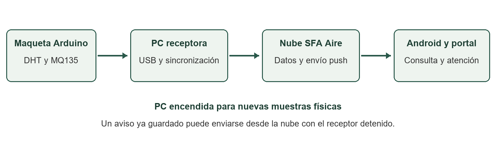

*Cómo llegan las mediciones desde Arduino hasta el portal y el teléfono.*

La PC y el Arduino deben permanecer encendidos para obtener nuevas mediciones. El programa de la PC que recibe los datos se llama receptor. Una vez guardado un aviso en la nube, puede enviarse al teléfono aunque ese receptor se detenga. Con la PC apagada podrá consultar los datos guardados, pero no recibirá nuevas mediciones de esa maqueta.

| Persona | Puede hacer en su aula |
| --- | --- |
| Administrador | Consultar, atender, administrar accesos y PC, configurar reglas y ejecutar ensayos autorizados. |
| Docente | Consultar mediciones e historial y marcar avisos como atendidos. |
| Observador | Consultar los apartados disponibles; no atender ni administrar. |

Los permisos se asignan por aula. Por eso, al cambiar de aula puede encontrar opciones diferentes. Crear aulas nuevas requiere una autorización adicional; no todas las cuentas administradoras la tienen.

Para consultar basta un navegador o la app Android. Para recibir mediciones nuevas del Arduino, además necesita la PC receptora. Un teléfono no reemplaza a esa PC.

## 02 Requisitos y archivos de instalación

Los archivos publicados se encuentran en https://github.com/hfreedo/SFA-Aire-Portal/releases. Esa página reúne versiones anteriores y actuales: compruebe el nombre del archivo antes de descargarlo.

| Elemento | Archivo o requisito |
| --- | --- |
| Windows | SFA_Aire_Windows_0.8.0_portable_x64.zip. Windows 10 u 11 de 64 bits; compilado y verificado en Windows 11 x64. |
| Android de este manual | SFA_Aire_0.8.2.apk, disponible en Entregas de esta instalación. Solicítela al responsable. Android 8 o posterior. |
| Consulta web | Navegador actualizado e internet; no necesita instalar el receptor para consultar la nube. |
| Avisos Android | Internet, servicios de Google Play, permiso de notificaciones y registro del teléfono en el aula. |
| Maqueta | Placa con el programa de Arduino correspondiente, sensores preparados, cable USB de datos y controlador USB si corresponde. |

Un portable es un programa que se utiliza después de extraer su carpeta, sin un instalador adicional. El ZIP Windows 0.8.0 incluye la app Android 0.8.0. Este manual describe Android 0.8.2: solicite ese APK por separado al responsable. APK es el archivo de instalación de Android. Al revisar las descargas el 27 de octubre, la actualización pública era 0.8.1 y la 0.8.2 solo estaba disponible en la carpeta del proyecto.

El portable ya contiene lo necesario para ejecutar SFA Aire: no necesita instalar Python ni Node.js. La placa Arduino sí debe tener cargado su programa. Según el modelo, el responsable técnico también debe instalar un controlador para que Windows reconozca el USB.

Windows puede mostrar una advertencia porque los ejecutables no tienen firma digital de editor. La app Android es una versión piloto, no una publicación en Play Store. Use los archivos entregados por el responsable o por el repositorio oficial. Si duda de un archivo, solicite que se compare su código de comprobación SHA256. No desactive las protecciones generales del equipo.

Si recibió solamente código fuente, solicite el portable al responsable. Para usar el sistema no necesita compilar programas ni modificar la base de datos.

## 03 Elegir cómo acceder al sistema

El portal en internet es https://sfa-aire-aulas.web.app/remoto. Puede abrirlo desde una PC o un teléfono para consultar sus aulas, avisos e historial. También permite administrar el sistema si su cuenta tiene ese permiso. Para conectar el Arduino por USB debe usar el panel de Windows.

En Windows, el panel abre el portal local de esa instalación. Es el recorrido apropiado para asignar la PC y controlar el puerto USB. Abra siempre desde el panel: el puerto local puede variar si otra instalación está usando el habitual.

Android está pensado para consultar el aula y recibir avisos. Iniciar sesión en un navegador no inicia sesión automáticamente en la app, ni al revés. Use su propia cuenta en ambos.

1. Para explorar sin cuenta, pulse **Explorar demostración sin cuenta** en web o **Explorar demostración** en Android.
2. Busque el rótulo **DEMOSTRACIÓN** y las etiquetas **SIMULACIÓN**.
3. Recorra las pantallas. Los datos son ejemplos y las acciones reales permanecen restringidas.
4. Salga de la demostración para iniciar sesión con su cuenta.

**Explorar demostración** sirve para conocer las pantallas sin guardar ni enviar nada. En cambio, las pruebas del **Laboratorio**, iniciadas por un administrador con su cuenta, pueden guardar mediciones de ejemplo y enviar notificaciones reales con el rótulo SIMULACIÓN.

Para comprobar que un teléfono recibe avisos, registre la app y siga la prueba del capítulo 22. Recorrer la demostración no realiza ese registro.

## 04 Instalar SFA Aire en Windows

1. Descargue el ZIP portable indicado en el capítulo 02.
2. En el Explorador de Windows, haga clic derecho sobre el ZIP y seleccione **Extraer todo**. Elija una carpeta propia con permiso de escritura, por ejemplo Documentos\SFA_Aire.
3. Abra la carpeta extraída y ejecute **Panel SFA Aire.exe**. Conserve junto al panel todos los archivos y subdirectorios del paquete.
4. Pulse **Abrir SFA Aire**. El panel inicia el receptor de esa carpeta y abre el navegador.
5. En el portal, ingrese con su cuenta o explore la demostración. Para una maqueta, continúe en el capítulo 19.

No ejecute el programa desde la vista del ZIP ni copie únicamente el EXE. No mezcle archivos de distintas versiones en una carpeta usada. El primer acceso y la primera vinculación de PC necesitan internet.

| Control del panel | Para qué sirve |
| --- | --- |
| Abrir SFA Aire | Abre el sistema y pone en marcha el servidor de esta instalación. |
| Conectar Arduino | Abre el portal de esta PC para asignarle un aula y conectar la placa. |
| Abrir demostración | Abre ejemplos aislados para conocer la interfaz sin nube. |
| Instalar por Wi-Fi | Ofrece temporalmente la APK incluida; necesita PC y teléfono en la misma red. |
| Actualizar estado | Comprueba el estado de los componentes del panel. |
| Detener monitoreo | Detiene el receptor y la demostración de esta carpeta. |

Al cerrar el panel, elija **Cerrar panel y mantener monitoreo** si la PC debe seguir recibiendo mediciones, o **Detener monitoreo y salir** para terminar. Cerrar una pestaña del navegador no detiene el receptor.

Debería abrirse la pantalla de acceso o la demostración. El receptor se comunica con el navegador dentro de la misma PC; no necesita cambiar el router. Si no se abre, consulte el estado que muestra el panel antes de intentar otra instalación.

## 05 Activar su cuenta mediante una invitación

Para crear su cuenta, pida al administrador una invitación para su correo y su aula. Recibirá un enlace privado o un código QR que deberá abrir o escanear. El sistema no envía ese enlace por correo automáticamente: el administrador debe compartirlo con usted. La invitación vence en una hora.

1. Abra el enlace privado que recibió. Si tiene el enlace copiado, use **Tengo una invitación**, péguelo completo y pulse **Continuar**.
2. Si es una cuenta nueva, verá **Activa tu cuenta**. Compruebe el **Correo de la invitación**; no se modifica desde ese formulario.
3. Escriba una contraseña propia en **Crea tu contraseña** y repítala en **Confirma tu contraseña**. Debe tener entre 12 y 128 caracteres. Guárdela en un lugar seguro y no se la envíe al administrador.
4. Pulse **Crear contraseña y entrar** y espere la confirmación. El acceso al aula se asigna al aceptar.
5. Si ya tiene cuenta, verá **Acepta tu invitación**: use su contraseña actual y pulse **Aceptar y entrar**. La invitación no cambia esa contraseña.

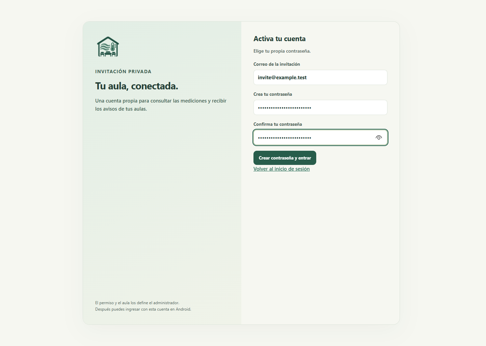

*Alta por invitación en una prueba controlada. El correo example.test es ficticio; no se muestra un enlace ni QR utilizables.*

En Android, **Tengo una invitación** abre el navegador. Complete allí la activación, vuelva a SFA Aire e ingrese con su correo y contraseña. La sesión del navegador no se transfiere a la app.

Si el enlace venció, fue revocado o no corresponde a su correo, solicite uno nuevo. Si olvidó su contraseña, contacte al administrador: esta versión no tiene un botón para recuperarla desde el acceso. Después de ingresar, active los avisos del teléfono como se explica en el capítulo 15.

## 06 Iniciar sesión y elegir un aula

1. Abra el portal público o el portal que inicia el panel Windows.
2. En **Ingresar al monitoreo**, complete **Correo electrónico** y **Contraseña** y pulse **Ingresar**.
3. Espere a que termine de cargar la lista de aulas. Si aparece un error, use la opción de reintento; todavía no se pudo consultar la lista.
4. Elija el aula en **Aula seleccionada**. Compruebe su nombre antes de leer, atender o configurar algo.
5. Use **Actualizar** para volver a consultar los datos.

Si la lista se cargó pero no tiene aulas, pida al responsable que revise su invitación y su acceso al aula. Tener cuenta no le da acceso a todas las aulas. Para usar otra cuenta, cierre primero la sesión actual.

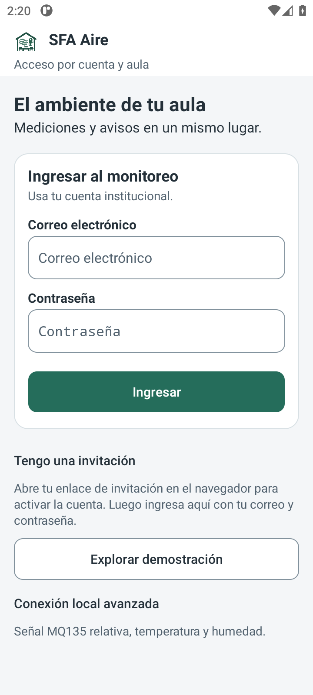

*Acceso Android 0.8.2 ejecutado en emulador. Los campos de cuenta son equivalentes al acceso web.*

Ante un error de correo o contraseña, revise los datos antes de reintentar. Si la aplicación indica falta de confirmación o acceso, solicite la revisión de su cuenta. Si hay fallo de red, recupere la conexión y use **Volver a intentar** o **Volver a ingresar**, según la pantalla.

En una PC compartida, pulse **Cerrar sesión** al terminar. En Android utilice **Cerrar sesión y desvincular teléfono**, explicado en el capítulo 25. Cerrar la ventana no garantiza el cierre de la sesión.

Al ingresar debería ver el nombre de su aula y las opciones permitidas para su cuenta. El acceso habitual pide correo y contraseña; no necesita claves administrativas de Supabase o Firebase.

## 07 Consultar las mediciones en el portal

El menú reúne **Mis aulas**, **Avisos** e **Historial**. Según sus permisos también verá **Conexión Arduino**, **Administración** y **Laboratorio**. En pantalla pequeña, utilice la navegación disponible y mantenga visible el aula seleccionada.

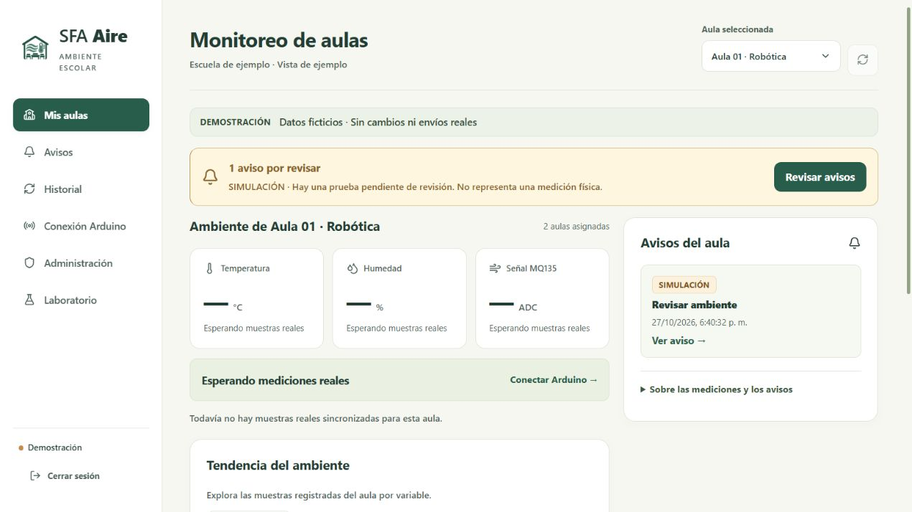

*Portal 0.8.0 en demostración. Menú lateral, selector de aula, aviso pendiente y tarjetas de sensores.*

1. En **Mis aulas**, verifique el nombre del aula y la conexión.
2. Distinga **ARDUINO REAL**, que corresponde a la maqueta, de **Pruebas y simulaciones**, que contiene valores generados para ensayar el sistema.
3. Lea temperatura en °C, humedad en % y señal MQ135 en ADC. ADC es el número de la lectura analógica, no una concentración de gas. El valor **× referencia** compara esa señal con la referencia guardada. Revise también cuándo se recibió la muestra.
4. Si hay un aviso pendiente, use **Revisar avisos** o **Ver aviso**.
5. Para explorar cambios anteriores, pulse **Ver historial**.

**Esperando mediciones reales** significa que no hay muestras físicas sincronizadas para esa aula. Los guiones en las tarjetas no equivalen a un valor cero. Si hay muestras simuladas, pueden aparecer en una sección separada aunque todavía no exista Arduino conectado.

**Sin atención pendiente** significa que la consulta no muestra avisos por atender. Compruebe también el origen y la fecha de la última lectura: puede no haber avisos aunque la maqueta esté desconectada.

## 08 Interpretar las mediciones y sus estados

| Mensaje | Cómo interpretarlo y qué revisar |
| --- | --- |
| Sin variación sostenida | No se confirmó una variación que cumpla los umbrales y tiempos configurados. No es una certificación sanitaria. |
| Variación sostenida | Se alcanzó el nivel de aviso durante el tiempo configurado. Revise ambiente y lectura. |
| Revisar ambiente | Se confirmó una alerta. Consulte el aviso y actúe según el procedimiento de la institución. |
| Revisar sensores | Alguna medición es inválida o se detectó un fallo. Revise alimentación, conexiones y diagnóstico. |
| Estabilizando sensor | Está en la espera inicial. No sustituye el acondicionamiento del módulo. |
| Falta referencia | Falta medir y guardar la referencia del MQ135, o confirmar que el sensor fue acondicionado. |
| Sin datos recientes | La última lectura ya es antigua o no hay datos. No permite conocer el estado actual. |
| Monitoreo detenido | El receptor no está recibiendo mediciones. Debe iniciarse de nuevo para obtenerlas. |

Una **lectura vencida** es un dato guardado que ya es demasiado antiguo para mostrarlo como actual. En el receptor USB ocurre después de más de 10 segundos sin muestra válida. En la nube se permiten hasta 95 segundos porque las mediciones se envían normalmente cada minuto. Por eso las pantallas local y remota pueden actualizarse en momentos diferentes.

La fecha de un aviso puede ser diferente a la de la lectura actual. En Android puede tocar la antigüedad para ver la fecha exacta. Si una notificación llega con retraso, revise cuándo ocurrió el aviso antes de interpretarlo como una situación nueva.

El DHT mide temperatura y humedad. El MQ135 responde a distintas sustancias y su lectura depende de la alimentación y preparación del sensor. Un valor como 560 ADC no equivale a 560 ppm. La comparación **× referencia** tampoco identifica un gas.

Si se pierde la conexión o falla el sensor, revise la fecha de los últimos datos. El color que tenía una lectura anterior no describe el estado actual. Para comunicar una situación, use el medio acordado por su institución.

## 09 Consultar y atender avisos en la web

1. Seleccione el aula y abra **Avisos**.
2. Use **Pendientes**, **Atendidos** o **Todos**. Revise origen, condición, fecha y nota del aviso que quiere atender.
3. Si puede realizar la acción, pulse **Marcar atendido**. La atención es directa y no obliga a escribir un comentario.
4. Si desea explicar lo realizado, use **Atender con comentario**. En **Marcar aviso como atendido**, escriba la **Nota opcional** y confirme con **Marcar atendido**. La nota admite hasta 500 caracteres.
5. Espere la confirmación y compruebe el aviso en **Atendidos**. **Cancelar** cierra el formulario sin guardar.

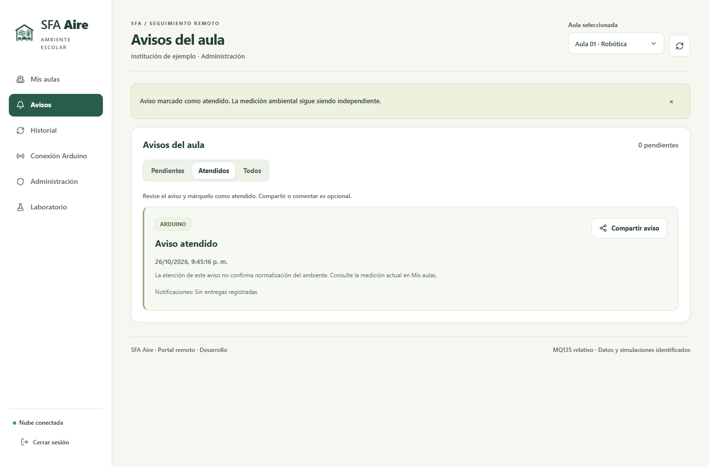

*Vista web de avisos con datos de ejemplo. El aviso atendido sigue conservando su origen y su fecha.*

Si falla el guardado, el formulario conserva la nota. Lea el error antes de reintentar. Si otra persona modificó el aviso, actualice y revise su estado; no suponga que el intento anterior se guardó.

**Marcar atendido** indica que usted dio por atendido el aviso. Las demás personas del aula verán ese estado cuando actualicen la pantalla. La medición sigue siendo independiente: atender no significa que los valores hayan vuelto a la normalidad. Tampoco se atiende un aviso automáticamente al abrir su notificación o al recuperarse los valores del sensor.

**Compartir aviso** permite elegir una aplicación de mensajería u otro medio disponible. Si el navegador no ofrece ese selector, se copia el texto para que usted lo pegue donde corresponda. Debe completar el envío en la aplicación elegida. Compartir no cambia la atención del aviso. Los observadores pueden consultar, pero no atender.

## 10 Consultar el historial

1. Elija el aula y abra **Historial**.
2. En **Origen**, seleccione **Arduino real** o **Simulación**.
3. En **Variable**, elija **Señal MQ135**, **Temperatura** o **Humedad**.
4. Pulse **Consultar últimas 60 muestras**. Espere la respuesta antes de cambiar de consulta.
5. Observe la gráfica y la tabla **Detalle de muestras**. Cada fila conserva fecha, valores, referencia y estado.

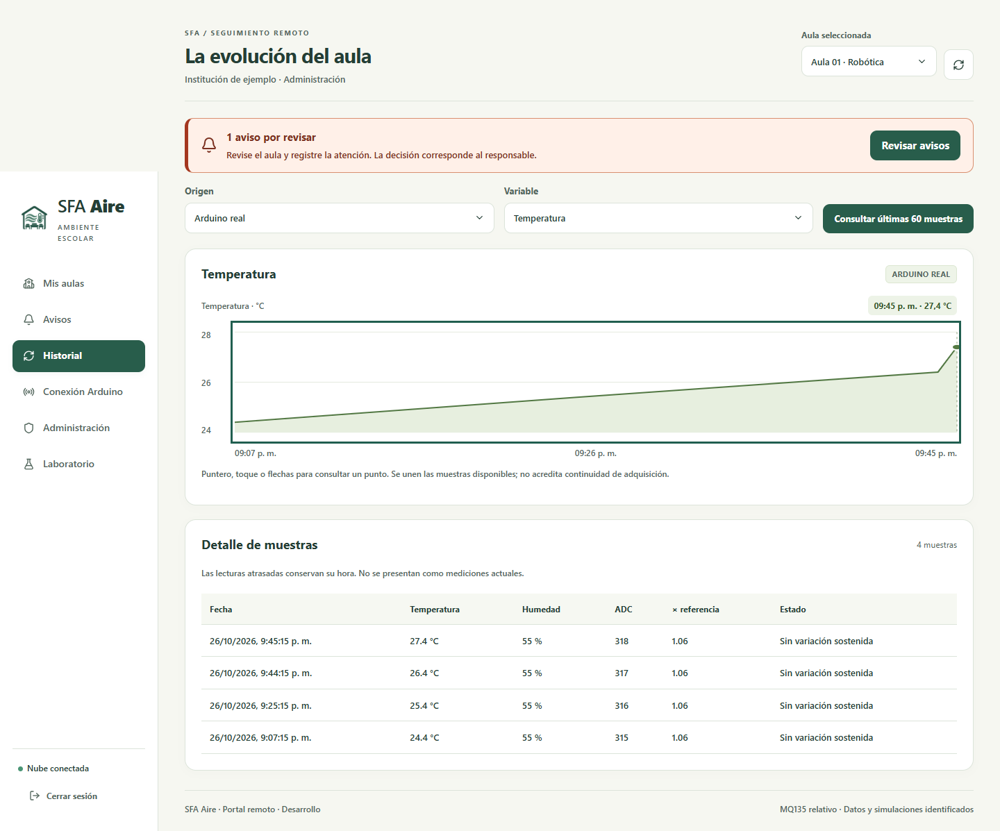

*Historial del portal en una prueba de interfaz. La gráfica representa una consulta de ejemplo.*

La gráfica muestra hasta 60 muestras del origen elegido, no todas las mediciones desde que comenzó a usarse el sistema. En una pantalla pequeña puede desplazar la tabla horizontalmente.

Si cambia de aula u origen, vuelva a consultar. Si no aparecen filas, revise la selección y compruebe si se registraron datos de ese origen. Una tabla vacía no equivale a una medición de cero.

Las lecturas que se sincronizan después de un corte de red conservan su hora original. Una fecha antigua sigue siendo histórica aunque aparezca ahora en la nube. La versión descrita no ofrece un botón general de exportación del historial.

Compruebe la variable, el origen y las fechas antes de interpretar la gráfica. Para conocer la última lectura disponible, vuelva a **Mis aulas**.

## 11 Instalar o actualizar la app Android

1. Solicite al responsable **SFA_Aire_0.8.2.apk**, disponible en la carpeta Entregas del proyecto. Al preparar esta edición, ese archivo aún no estaba publicado en la página de descargas. Si se publica después, compruebe su nombre y versión.
2. Abra el APK en el teléfono. Si Android lo solicita, autorice al navegador o gestor de archivos que está usando a instalar esa app. La ubicación de este permiso depende del modelo de teléfono.
3. Complete la instalación. Si tiene una versión piloto con la misma firma, instale la actualización sobre ella para conservar los datos locales.
4. Abra **SFA Aire**. Active primero su cuenta si recibió una invitación y luego pulse **Ingresar** con correo y contraseña.
5. Revise **Ajustes** y confirme que la versión es 0.8.2. Continúe con el registro de avisos del capítulo 15.

Para una descarga Wi-Fi desde Windows, coloque PC y teléfono en la misma red, pulse **Instalar por Wi-Fi** y compruebe la versión indicada como **App** antes de descargar. Escanee su QR o abra el enlace. Mantenga el servicio disponible durante la descarga; el enlace es temporal, normalmente de 30 minutos. No es el QR privado de invitación.

El portable Windows 0.8.0 incluye una APK 0.8.0. Su herramienta Wi-Fi no garantiza la versión 0.8.2. Para obtenerla, use el archivo separado proporcionado por el responsable; no cambie archivos del portable al azar.

No necesita conectar el teléfono por USB para instalar por Wi-Fi. Una vez instalada y registrada la app, el teléfono puede recibir avisos fuera de esa red siempre que tenga internet.

Si Android indica que no puede actualizar por una firma incompatible, solicite al responsable que revise el archivo. Evite desinstalar como primera solución, porque perdería el archivo personal de avisos. La versión 0.8.2 fue revisada en un emulador; todavía falta comprobar esta versión en el Samsung A02 usado por el proyecto.

## 12 Leer Mi aula en Android

La navegación inferior contiene **Mi aula**, **Avisos** y **Ajustes**. Si su cuenta dispone de varias aulas, seleccione primero la que desea consultar. La selección de aula no registra automáticamente el teléfono para todas ellas.

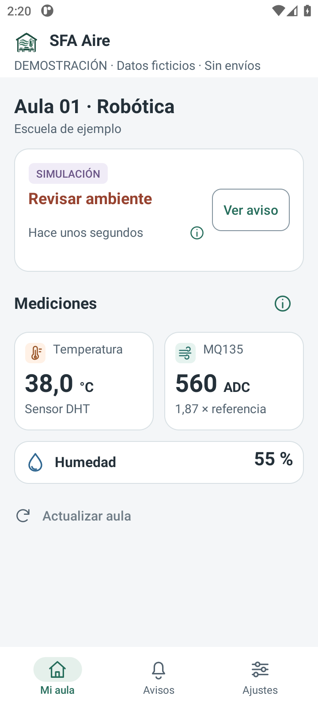

*Mi aula en Android 0.8.2, con datos de ejemplo. Captura de emulador.*

1. En **Mi aula**, lea el nombre de la institución y del aula.
2. Compruebe el rótulo de origen y el estado. **SIMULACIÓN** identifica un ejemplo o un ensayo, no un sensor real.
3. Revise las tarjetas de temperatura y MQ135 y el valor de humedad. Los valores no disponibles no se sustituyen por cero.
4. Toque la antigüedad de la lectura si necesita su fecha exacta. Abra **Información de sensores** para consultar su interpretación.
5. Use **Actualizar aula** para consultar los datos de nuevo y **Ver aviso** para abrir el aviso pendiente.

Si la lectura está vencida, los valores que ve corresponden a otro momento. Pulsar Actualizar no hace que el sensor mida otra vez: la nueva muestra debe llegar desde la maqueta y la PC. El teléfono necesita internet para consultar esos datos.

## 13 Abrir y atender un aviso en Android

1. Toque la notificación de SFA Aire o abra la pestaña **Avisos**. Si sigue conectado con una cuenta autorizada, la notificación abre el aviso correspondiente.
2. Elija **Pendientes** o **Atendidos** y pulse **Detalles y acciones** para desplegar la información.
3. Compruebe fecha, aula, origen y lectura asociada. Esa lectura se guardó cuando se creó el aviso o cuando pasó a un nivel de mayor alerta. Para conocer la lectura más reciente, consulte Mi aula.
4. Si puede atenderlo, pulse **Marcar atendido**. Para dejar explicación, use **Atender con nota** y confirme el formulario.
5. Espere la confirmación. Las demás personas del aula verán el aviso atendido cuando actualicen la pantalla.

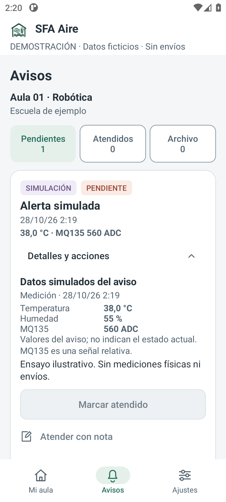

*Aviso desplegado en Android 0.8.2, emulador y datos de demostración. La lectura conserva su fecha.*

Los avisos antiguos pueden indicar **Sin lectura asociada conservada**: no se guardó la medición que los originó. En **Detalles de entrega** puede revisar si se aceptó el envío, si llegó a la app y si se abrió.

**Compartir aviso** es opcional y usa el canal que usted elija. Abrir, compartir o atender no confirma que el ambiente se haya normalizado. Para revisar el estado actual, vuelva a **Mi aula**. Si faltan permisos, se perdió la sesión o cambió el aviso, actualice y revise el mensaje antes de repetir una acción.

## 14 Organizar el archivo personal de Android

**Pendientes** y **Atendidos** muestran el estado del aviso que comparten las personas del aula. **Archivo** solo organiza su propia bandeja en ese teléfono.

1. En Avisos, despliegue **Detalles y acciones** del aviso que quiere apartar de su bandeja.
2. Pulse **Archivar en este teléfono**.
3. Abra **Archivo** para volver a encontrarlo. Puede haber un aviso pendiente allí: archivarlo no lo atiende.
4. Para recuperarlo, pulse **Restaurar en la bandeja**. Volverá a Pendientes si aún no se atendió, o a Atendidos si alguien ya lo atendió.

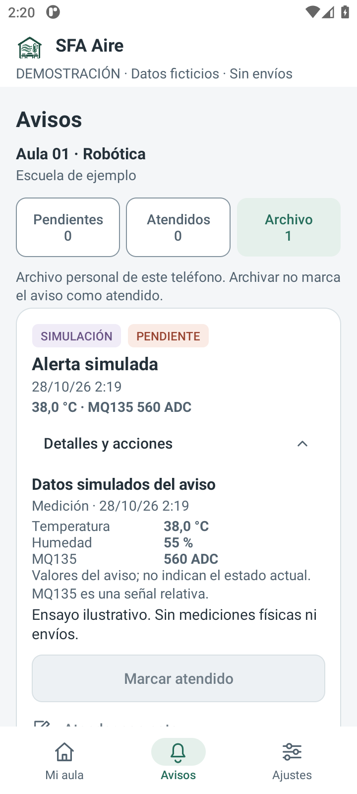

*Archivo personal con un aviso que sigue pendiente. Ejemplo en emulador.*

Archivar aparta el aviso de su bandeja, pero no lo marca como atendido, no lo elimina para otras personas ni cancela otros envíos. Si el aviso requiere una respuesta, atiéndalo antes de archivarlo.

El archivo no se comparte entre teléfonos. Se conserva al actualizar la app con una versión compatible y al volver a entrar con la misma cuenta en ese dispositivo. Borrar los datos o desinstalar la aplicación elimina esa organización personal. Puede guardar hasta 500 referencias de avisos.

La bandeja recibe hasta 30 avisos recientes del aula. No muestra todo el historial desde la instalación. Si necesita buscar un aviso más antiguo que no aparece, consulte al administrador.

## 15 Activar avisos y preferencias del teléfono

1. Ingrese con su cuenta y seleccione el aula correcta.
2. Abra **Ajustes** y consulte **Avisos en este teléfono**.
3. Si figura **PERMISO ANDROID PENDIENTE**, pulse **Revisar permiso de Android** y habilite las notificaciones de SFA Aire en la pantalla del sistema operativo.
4. Si falta registro, pulse **Activar avisos en este teléfono** y espere confirmación. Si ya figura **AVISOS ACTIVOS**, compruebe el aula; no es necesario activar de nuevo.
5. Solo para participar en ensayos, active **Incluir simulaciones** y pulse **Guardar preferencia**. Mover el interruptor sin guardar no confirma el cambio remoto.
6. Verifique **AVISOS ACTIVOS** y que el aula registrada sea la que espera.

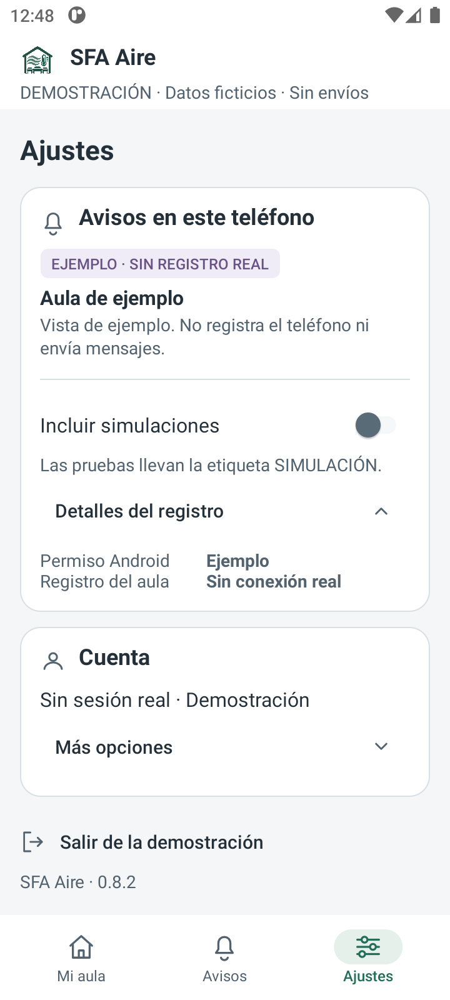

*Ajustes y detalles del registro en Android 0.8.2. Esta captura de DEMO no muestra un registro FCM real.*

En **Detalles del registro**, revise **Permiso Android**, **Registro del aula**, **Actualizar registro** y **Permisos en Android**. Si indica otra aula, revise su selección y registre la correspondiente; no suponga registro multiaula automático.

Aceptar la invitación o iniciar sesión no sustituye estos pasos. El teléfono necesita internet y servicios Google Play para FCM. Si deja de participar en ensayos, desactive simulaciones y guarde la preferencia. Permiso, registro, aceptación de Firebase y recepción son comprobaciones diferentes.

## 16 Crear y editar aulas

Este apartado requiere permiso de administrador. Si no aparece en el menú y necesita usarlo, solicite que el responsable revise su acceso.

1. Abra **Administración** y seleccione el aula.
2. En **Resumen**, use **Ver personas** o **Ver PC del aula** para comprobar su preparación.
3. Para cambiar el nombre o la institución, pulse **Editar datos**, complete **Editar aula** y use **Guardar aula**.
4. Si su cuenta tiene permiso para crear aulas, use **Nueva aula**, complete el nombre y, si lo desea, la institución. Pulse **Crear aula**. El nombre admite de 2 a 100 caracteres; la institución, hasta 120.
5. Pulse **Actualizar configuración** para revisar el estado y permisos vigentes.

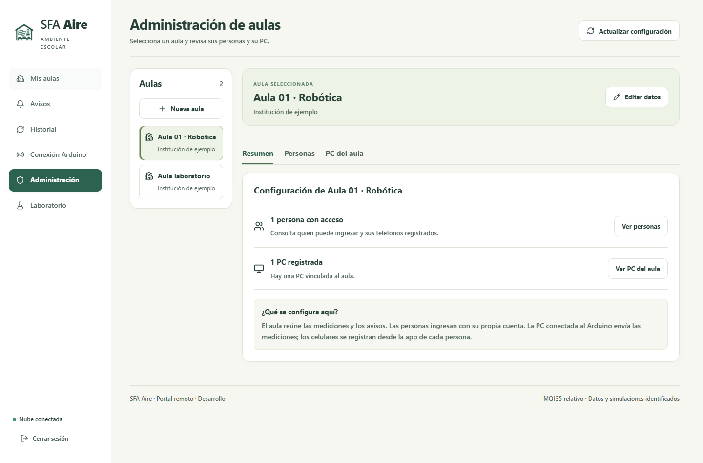

*Resumen administrativo en un ensayo de interfaz con aulas de ejemplo.*

El aula reúne sus lecturas y avisos. Las personas acceden por cuenta y permiso; la PC receptora aporta mediciones; el teléfono se registra desde Android. No son elementos intercambiables.

Después de crear un aula, agregue a las personas que tendrán acceso. Si conectará una maqueta, vincule su PC y revise las reglas. Cada persona debe registrar su teléfono desde Android. Si **Nueva aula** no está disponible, puede faltar el permiso necesario o haberse alcanzado un límite del sistema; consulte al responsable.

## 17 Invitar personas y gestionar accesos

1. En **Administración**, seleccione el aula y abra **Personas**.
2. Pulse **Agregar persona**. En **Cómo agregar**, use **Invitar · la persona acepta su acceso**.
3. Complete **Correo de la persona** y **Permiso en esta aula**: Docente, Observador o Administrador. Asigne solo el permiso necesario.
4. Pulse **Crear invitación**. En **Invitación lista**, use **Copiar enlace** o comparta privadamente el QR con el destinatario.
5. Pida que acepte dentro de una hora y complete el registro Android si recibirá avisos. No se envía correo automáticamente.

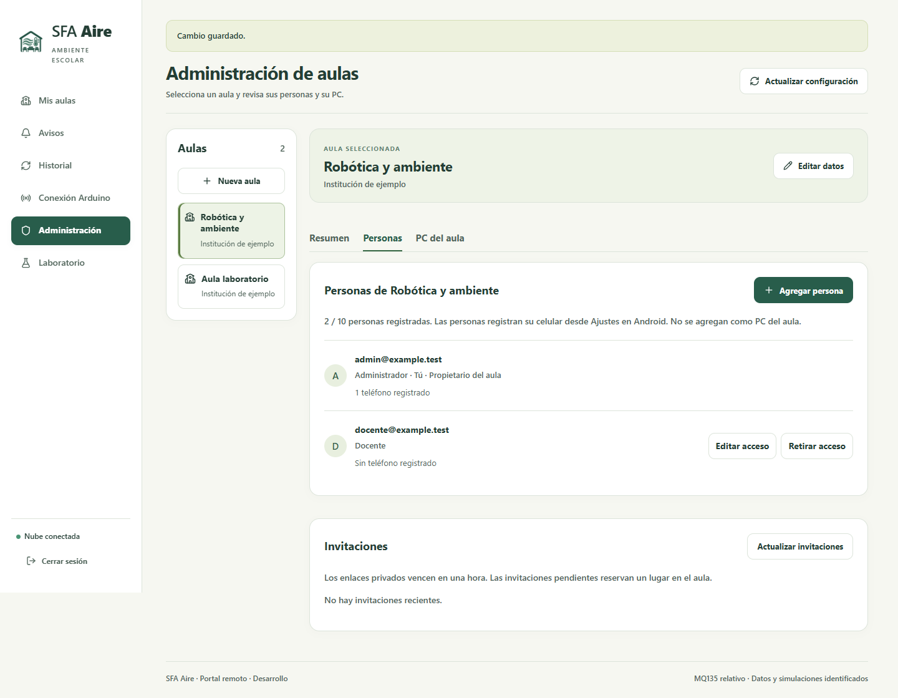

*Personas e invitaciones en una prueba controlada. Los correos de ejemplo no son credenciales para ingresar.*

Comparta la invitación solo con su destinatario: quien tenga el enlace podría intentar activar esa cuenta. El enlace se muestra una sola vez al crearlo. La persona nueva define su contraseña; una cuenta existente mantiene la suya. Para agregar una cuenta ya creada, también puede usar **Vincular una cuenta existente**, indicar correo y permiso y pulsar **Agregar al aula**.

Para cambiar permisos use **Editar acceso** y **Guardar acceso**. **Retirar acceso** impide que esa persona siga consultando el aula; conserva su cuenta y los registros anteriores. Algunas acciones no están disponibles sobre el propietario del aula o sobre su propia cuenta. Compruebe el correo y el aula antes de confirmar.

En **Invitaciones**, use **Revocar invitación** si una invitación pendiente ya no debe utilizarse. Si la persona ya aceptó, debe revisar su acceso en la lista de Personas. Se permiten 10 lugares por aula contando las invitaciones pendientes que no vencieron, y 10 invitaciones en todo el proyecto por cada 24 horas. Si se alcanza un límite, revise la lista con el responsable.

## 18 Administrar las PC del aula

En **Administración → PC del aula** se administran los equipos que envían mediciones. No agregue aquí los celulares: cada persona registra su teléfono desde Ajustes de Android.

1. Seleccione el aula correcta y abra **PC del aula**.
2. Revise nombre, vínculo, estado y último contacto de cada PC. **PC vinculada** no demuestra por sí solo que el Arduino esté leyendo en ese instante.
3. Desde la PC conectada al Arduino, use **Conectar Arduino en esta PC** y siga los pasos del capítulo 19 para asignarle un aula.
4. Para retirar una PC que ya no debe enviar datos, pulse **Retirar PC**, lea el contexto, indique el motivo solicitado y confirme.
5. Actualice la configuración y compruebe **Acceso retirado**. El historial anterior se conserva; la credencial de ese receptor deja de estar autorizada.

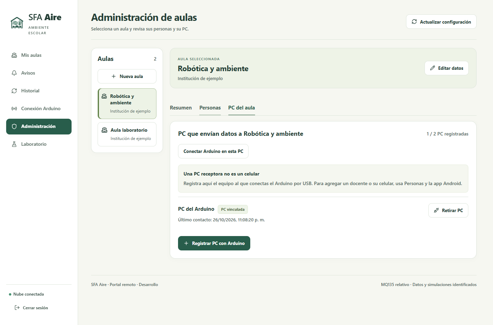

*Gestión de PC en una prueba controlada. El vínculo de receptor es diferente al registro de un teléfono.*

Se permiten hasta dos PC activas por aula. Antes de añadir otra, identifique las existentes; no retire una instalación ajena para liberar un lugar sin saber para qué se usa.

La ruta avanzada **Registrar PC con Arduino → Nombre de la PC → Crear vínculo de PC → Descargar configuración PC** genera un archivo privado para autorizar a esa PC. Pida al responsable técnico que lo configure; no lo comparta en un grupo ni lo copie a Android. Para el primer uso, siga la asignación automática del capítulo 19.

## 19 Vincular la PC y conectar Arduino

Realice estos pasos en la PC conectada a la maqueta. Abra el portal desde **Panel SFA Aire.exe**, no desde la dirección pública de internet, que solo muestra la orientación para usar el panel local.

1. Conecte el Arduino con un cable USB de datos y cierre el Monitor Serie del IDE.
2. Abra el panel, **Abrir SFA Aire**, ingrese como administrador y seleccione el aula.
3. Abra **Conexión Arduino**. Si aún no está asignada, pulse **Usar esta PC para esta aula** y espere confirmación.
4. Pulse **Refrescar puertos**. En **Puerto COM**, elija la placa USB correcta; no copie COM7 del ejemplo, su número puede ser otro.
5. Pulse **Conectar Arduino**. El receptor se comunica a 115200 baudios y envía el comando MONITOR al programa cargado en Arduino para que empiece a transmitir.
6. En **Datos recibidos en esta PC**, compruebe que llegan valores y que la hora se actualiza. Revise también si hay envíos pendientes a la nube. Después consulte esas mediciones en Mis aulas y Android.

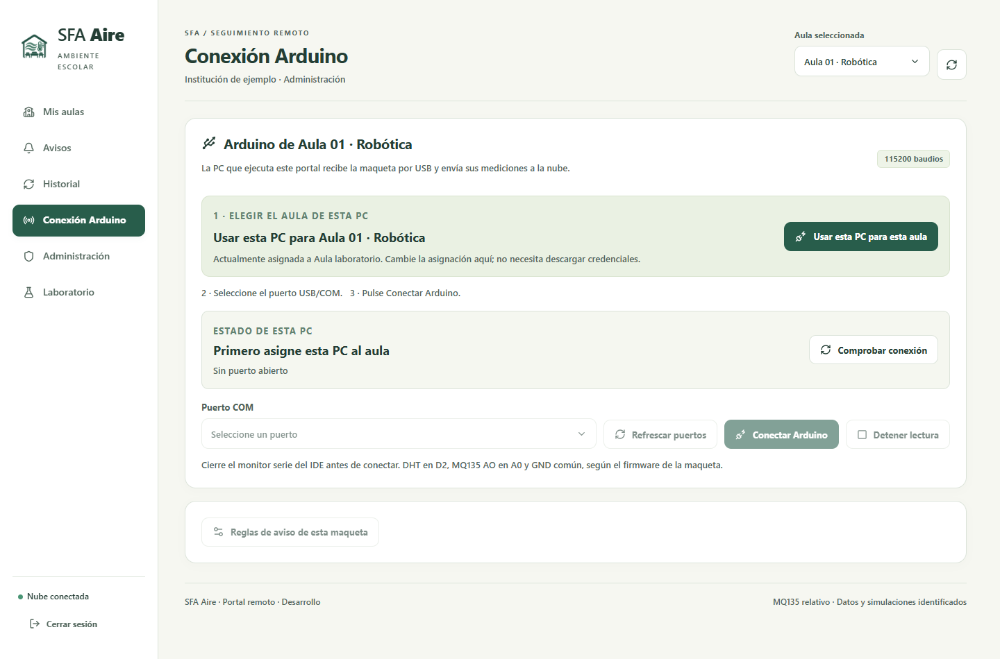

*Pantalla de asignación de una PC a un aula. Ejemplo sin Arduino conectado.*

Un puerto abierto puede no estar recibiendo datos. Use **Comprobar conexión** y revise los valores. **Detener lectura** envía el comando PARAR para dejar de recibir mediciones. Si solo aparecen puertos Bluetooth, la PC todavía no detectó la placa USB.

Cambiar el selector de aula no cambia automáticamente el aula de la PC. Para reasignarla necesita administrar ambas aulas, detener la lectura o la prueba y esperar a que no queden envíos pendientes. Los datos y avisos anteriores siguen perteneciendo al aula donde se registraron.

## 20 Preparar la maqueta y verificar sus conexiones

El responsable técnico debe revisar la placa, los sensores, la alimentación y el programa cargado en Arduino, llamado firmware. Desconecte la alimentación antes de cambiar cables.

| Componente | Conexión de esta versión |
| --- | --- |
| DHT DATA | Arduino D2. El programa está preparado para DHT22; debe adaptarse si usa DHT11. |
| DHT VCC y GND | Alimentación admitida por el módulo y GND común. Un DHT sin placa puede necesitar una resistencia adicional; consulte al responsable. |
| MQ135 AO | Arduino A0. Verifique que su tensión esté dentro del rango admitido. |
| MQ135 VCC y GND | Alimentación regulada según módulo y GND común. |
| MQ135 DO | No se utiliza. |
| Arduino USB | Cable de datos hacia la PC receptora. |

El calefactor del MQ135 no se alimenta desde un pin digital. Confirme el orden serigrafiado de VCC, GND y señales; no todos los módulos tienen los pines en el mismo orden. No una en paralelo dos salidas de 5 V. Coloque el DHT separado del calor del MQ135.

Si la placa todavía no tiene firmware, el responsable debe cargar **arduino/SFA_Aire_Aulas/SFA_Aire_Aulas.ino** con el tipo DHT correcto. El portable no carga automáticamente ese programa ni cambia DHT22 a DHT11. Una compilación correcta no verifica el cableado.

El acondicionamiento del MQ135 es su preparación y estabilización antes de usarlo como referencia. La espera inicial de 180 segundos del programa no lo sustituye. La documentación técnica citada por el proyecto contempla más de 48 horas en sus condiciones de ensayo; el responsable debe consultar la ficha del módulo instalado y comprobar su estabilidad.

Para aprender a usar el sistema, empiece con la simulación. No genere humo, combustión ni gases peligrosos dentro del aula para probar una alerta. Las capturas del manual no reemplazan la revisión del montaje.

## 21 Configurar las reglas de la maqueta

Las reglas se modifican con una cuenta administradora, desde la PC asignada al aula y conectada al sistema. Anote los valores anteriores y el motivo del cambio antes de guardar.

1. Entre en **Conexión Arduino** y despliegue **Reglas de aviso de esta maqueta**.
2. En **Referencia MQ135 (ADC)**, introduzca el valor obtenido al medir el sensor ya estabilizado en el entorno de referencia acordado. El valor 300 que usa el simulador no sirve como referencia para cualquier sensor.
3. Marque **Sensor MQ135 acondicionado y con referencia experimental** únicamente cuando se haya comprobado realmente.
4. Revise los niveles relativos y tiempos. Si corresponde, active **Activar avisos por temperatura** y configure sus umbrales.
5. Pulse **Guardar reglas** y espere confirmación. **Descartar cambios** recupera las reglas guardadas de la PC.

| Parámetro | Qué cambia |
| --- | --- |
| Aviso y alerta MQ135 | Niveles de comparación con la referencia. El nivel de alerta debe ser mayor que el de aviso. |
| Persistencia | Cuánto tiempo debe mantenerse la variación para generar el aviso. |
| Recuperación | Cuánto tiempo deben mantenerse los valores de recuperación para cambiar el estado de la lectura. El aviso sigue pendiente hasta que alguien lo atienda. |
| Histéresis | Margen de retorno que evita que el estado cambie continuamente cuando la lectura está cerca del umbral. |
| Avisos por temperatura | Permite definir los niveles de aviso y alerta por temperatura. |

Los valores de demostración incluyen aviso 1,30 ×, alerta 1,60 ×, persistencia 12 s, recuperación 20 s e histéresis relativa 0,10. Por ejemplo, con una referencia de 300 ADC, 1,30 × corresponde a 390 ADC y 1,60 × a 480 ADC. Estos números explican el cálculo; no son límites sanitarios ni valores para copiar en cualquier montaje.

Si el sistema informa que las reglas cambiaron mientras editaba, consulte las reglas guardadas antes de reintentar. No marque el sensor como acondicionado solo para quitar un bloqueo. Un fallo del DHT, una señal fuera de rango, la pérdida de datos o la falta de referencia pueden impedir que se confirme un aviso.

## 22 Probar una notificación desde la nube

La prueba rápida permite comprobar si un aviso llega al teléfono sin conectar Arduino ni iniciar el receptor de la PC. Necesita una cuenta administradora del aula y un teléfono registrado que tenga habilitada la recepción de simulaciones.

1. En Android, complete Ajustes del capítulo 15 y guarde **Incluir simulaciones**.
2. En el portal, seleccione esa misma aula y abra **Laboratorio**.
3. En **Probar la notificación del celular**, revise los teléfonos habilitados y cuántas notificaciones quedan disponibles.
4. Si lo necesita, abra **Elegir valores de la prueba** y elija Temperatura, MQ135 o Ambos. Son valores de ejemplo, no lecturas del sensor.
5. Pulse una vez **Enviar aviso de prueba**. Revise el detalle del envío y compruebe el teléfono.
6. Abra la notificación y revise el aviso identificado como SIMULACIÓN. No lo confunda con una lectura actual del aula.

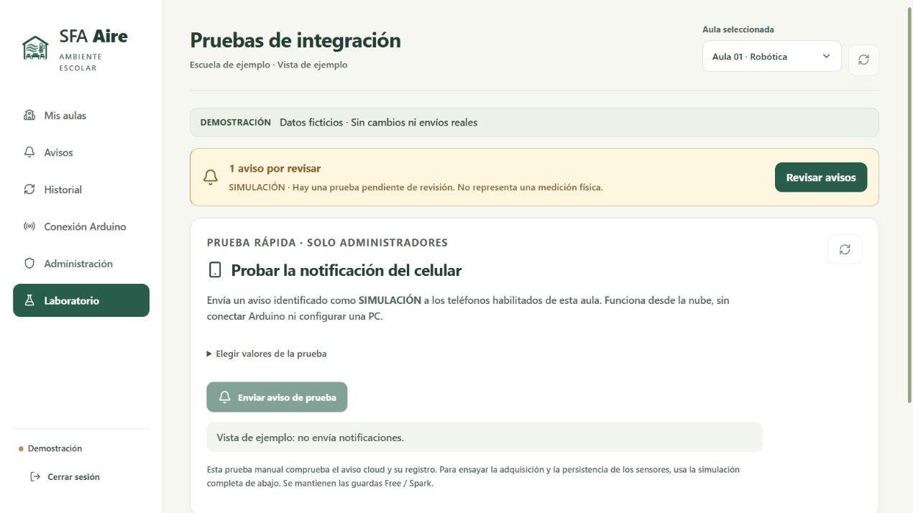

*Laboratorio 0.8.0 en DEMO. La misma vista informa que el ejemplo no envía notificaciones.*

El detalle distingue cuatro etapas: **Programadas** significa que se preparó el envío; **Aceptadas por FCM**, que Firebase lo aceptó; **Recibidas en app**, que la aplicación confirmó su llegada; **Abiertas**, que se abrió la notificación. Cada etapa informa algo diferente. Para atender el aviso debe realizar la acción del capítulo 09 o 13.

Si no llega, consulte el capítulo 24 antes de repetir. El sistema exige una espera entre pruebas y limita los envíos para cuidar el uso de los servicios gratuitos. Mientras haya envíos pendientes puede impedir una prueba nueva.

## 23 Ensayar el recorrido completo con la PC

La **Simulación completa con la PC · Avanzado** genera mediciones de ejemplo en la PC, aplica las reglas y guarda los resultados. También puede enviar avisos al teléfono si usted lo autoriza. Sirve para ensayar más pasos que la prueba rápida desde la nube.

1. Abra Laboratorio como administrador y despliegue la simulación completa.
2. Seleccione una PC vinculada que se haya comunicado recientemente. Revise la hora del diagnóstico para saber cuándo se comprobó su conexión.
3. Elija el escenario Temperatura, MQ135 o Ambos y revise los valores de ejemplo de temperatura, humedad y ADC.
4. Seleccione una duración acotada de 60, 90 o 180 segundos.
5. Si comprobará el envío al teléfono, marque **Recorrer la entrega FCM a celulares habilitados para simulación**. Si deja la casilla desmarcada, el ensayo no enviará esos avisos.
6. Si necesita interrumpir la lectura del Arduino, autorice **Permitir detener USB para que este receptor ejecute la prueba**. Compruebe antes que esa lectura no deba continuar.
7. Confirme que verificó Supabase Free y Firebase Spark sin facturación vinculada y pulse **Iniciar prueba acotada**.
8. Revise si se guardó la medición, se confirmó el aviso y se completaron las etapas de envío. Use **Actualizar diagnóstico** para revisar impedimentos y **Detener prueba** para terminar antes del plazo.

Al terminar, la PC deja de generar mediciones simuladas y conserva los datos de la prueba con su identificación. Revise si quedó un aviso pendiente. Antes de volver al monitoreo real, compruebe que el Arduino esté conectado y recibiendo mediciones.

Si la sección **Para iniciar** informa un impedimento, lea el motivo y compruebe la conexión de la PC. Si la prueba necesita detener USB, debe autorizarlo expresamente. Algunas mejoras recientes del diagnóstico todavía no están incluidas en el portable 0.8.0; consulte al responsable si necesita actualizarlo.

El sistema reserva por día 80 entregas para avisos reales y 20 para simulaciones. Una entrega corresponde a un teléfono destinatario; un aviso dirigido a varios teléfonos puede consumir varias. Los sobrantes de un grupo no pasan al otro. Son límites de SFA Aire, no las cuotas oficiales de los proveedores. También hay límites de almacenamiento y envío de datos. Si bloquean una prueba, consulte al responsable sin cambiar de plan ni desactivar las protecciones.

## 24 Solucionar problemas frecuentes

| Problema observado | Comprobaciones y siguiente paso |
| --- | --- |
| No puedo ingresar | Revise correo, contraseña y red. Si falta activación, complete la invitación. Sin recuperación disponible, contacte al administrador. |
| Ingreso pero no hay aulas | Espere a que termine la carga. Si la lista sigue vacía, pida al administrador que revise su cuenta y su acceso al aula. |
| Invitación vencida o revocada | Solicite una nueva. No comparta el enlace fallido en un grupo ni intente un registro libre. |
| No aparece Arduino | Cable USB de datos, alimentación y controlador. Refresque puertos. Los COM Bluetooth no son la placa. |
| Puerto ocupado | Cierre Monitor Serie y otras aplicaciones que usen esa placa. No cierre procesos desconocidos. |
| Puerto abierto sin lecturas | Pida al responsable que revise el programa de Arduino, la comunicación a 115200 baudios y el modelo DHT conectado. |
| Valores antiguos o sin datos recientes | Compruebe que la PC esté encendida, el USB conectado y la hora de recepción se actualice. Revise si hay envíos pendientes. |
| Falta referencia o revisar sensores | Revise montaje y acondicionamiento con el responsable. No copie un ADC de una captura. |
| No llega la notificación | Revise el aula registrada, AVISOS ACTIVOS, permiso Android, servicios Google Play e internet. Si es una prueba, confirme que guardó Incluir simulaciones. |
| Firebase aceptó el envío pero el teléfono no lo recibió | Revise sesión, conexión, permiso y restricciones de batería del teléfono. Consulte el detalle del envío antes de repetir la prueba. |
| No puedo atender | Necesita una cuenta docente o administradora, conexión y un aviso pendiente. En demostración no se guardan cambios. |
| Falló el guardado de una nota | Conserve el formulario, compruebe la conexión y revise si cambió el aviso. Espere la confirmación antes de darlo por guardado. |

Para pedir ayuda, indique la versión, el aula, la hora y el mensaje exacto que apareció. Aclare si estaba usando datos reales o una simulación. Si envía una captura, compruebe que no muestre una contraseña, una invitación privada u otros datos personales. El administrador puede consultar el número del aviso y de su envío para localizar el problema.

## 25 Cerrar el sistema y cuidar sus datos

Al terminar la jornada, revise los avisos pendientes. Si necesita seguir recibiendo mediciones durante la noche, mantenga la PC encendida, sin suspenderse y con el receptor en funcionamiento. Cerrar el navegador no detiene la lectura; al salir del panel puede elegir si mantiene o detiene el monitoreo.

En Android, vaya a **Ajustes → Más opciones → Cerrar sesión y desvincular teléfono**. Así sale de su cuenta y solicita retirar el registro de avisos de esa sesión. Si aparece un error al desvincular, pida al administrador que revise el registro antes de entregar el teléfono a otra persona.

Para actualizar la app Android, instale el APK compatible que le entregue el responsable sobre la app anterior. Después revise la versión, el aula y el registro de avisos. Recuerde que borrar los datos o desinstalar elimina su archivo personal de avisos.

Para actualizar SFA Aire en Windows, detenga el receptor de la carpeta que va a reemplazar y siga las instrucciones de la nueva entrega. Antes de mover una instalación usada, solicite una copia de seguridad de la configuración y los datos al responsable. No mezcle archivos de versiones distintas ni elimine carpetas de datos como solución rápida.

| Carpeta de una instalación usada | Por qué requiere cuidado |
| --- | --- |
| data | Puede contener mediciones, base local e identidad o clave de instalación. |
| secrets | Contiene vínculos y configuraciones privadas de la PC. |
| artifacts | Puede contener datos de demostración, temporales o QR. |

Para entregar el programa a otra persona, comparta el ZIP original de la descarga y el APK oficial. Una carpeta que ya utilizó puede contener datos y accesos privados: no la comprima para distribuirla. Cierre su sesión antes de compartir una PC.

SFA Aire utiliza Supabase Free y Firebase Spark sin facturación vinculada. Son servicios con límites de uso y pueden interrumpirse al agotarlos. Si aparece un problema de cuota, comuníquelo al responsable; no active un plan de pago ni elimine datos para continuar.

## 26 Comprobar el primer uso

Complete esta lista durante la prueba de su instalación. Si un paso no pudo comprobarse, anote qué falta y quién puede ayudar.

Lista de acceso y consulta

- Se identifica Windows/portal 0.8.0 y Android 0.8.2, sin confundir la APK incluida en el portable.
- La invitación fue aceptada por la persona correspondiente y permite ingresar con cuenta propia.
- El nombre del aula y el permiso son correctos; una cuenta ajena no debe ver sus datos.
- La persona distingue datos reales y simulados, y sabe reconocer una lectura antigua o no disponible.
- Puede consultar Avisos e Historial y sabe que atender un aviso no significa que los valores hayan vuelto a la normalidad.

Lista del teléfono

- Se verificó el permiso Android y AVISOS ACTIVOS para el aula prevista.
- La preferencia de simulación quedó guardada explícitamente.
- Una prueba autorizada queda identificada, llega al teléfono y puede abrirse, con fecha registrada.
- Se revisó comportamiento con pantalla bloqueada/segundo plano, red y batería según el dispositivo.
- La persona distingue Marcar atendido de Archivar en este teléfono.

Lista de adquisición física

- Se revisaron la placa, el programa de Arduino, el modelo DHT, las conexiones de los pines, la alimentación y el cable USB.
- La PC quedó vinculada al aula y el puerto recibe muestras válidas.
- La referencia MQ135 corresponde al montaje acondicionado y está documentada.
- Se encuentran las mediciones de la maqueta en PC, nube y Android, con su fecha y teniendo en cuenta el tiempo de sincronización.
- Al detener o desconectar la maqueta, aparece la indicación de que faltan datos recientes.

Repita estas comprobaciones en su propia instalación. Las pruebas anteriores del proyecto no sustituyen las de una nueva versión o dispositivo. Al preparar esta edición todavía faltaban la prueba de alta con otra persona, la comprobación del montaje físico y el ensayo de Android 0.8.2 en el Samsung A02.

Anote la fecha, la versión, el aula, los equipos utilizados y el resultado de la prueba. Deje también una lista de los pasos pendientes. No incluya contraseñas ni enlaces privados.

## 27 Glosario y referencias

| Término | Significado práctico |
| --- | --- |
| Aula | Contexto al que pertenecen mediciones, personas y avisos. |
| PC receptora | PC que recibe las mediciones de Arduino por USB y las envía a la nube. |
| ADC | Número de lectura analógica del MQ135; no concentración de un gas. |
| Referencia | Valor experimental del montaje usado para comparar la señal. |
| Persistencia | Tiempo de variación sostenida necesario para confirmar un aviso. |
| Notificación push | Aviso que llega al teléfono. SFA Aire utiliza el servicio Firebase Cloud Messaging, conocido como FCM, para enviarlo. |
| Recibido y abierto | Recibido indica que la app confirmó la llegada. Abierto indica que se abrió la notificación; no que se atendió el aviso. |
| Atendido | Aviso que una persona autorizada marcó como atendido; ese estado se comparte con el aula. |
| Archivo personal | Organización local del teléfono; no cambia la atención compartida. |
| SIMULACIÓN | Datos generados para una prueba; pueden producir una notificación real si el administrador habilita el envío. |
| Envíos pendientes | Mediciones o notificaciones guardadas que todavía deben enviarse. |

Esta edición explica cómo usar SFA Aire con los servicios ya configurados. La creación de proyectos en internet, los cambios de base de datos y la publicación de nuevas versiones corresponden al responsable técnico y se documentan por separado.

Para ampliar la información, los documentos del proyecto explican la instalación y privacidad en GUIA_PUBLICA.md; las invitaciones en PORTAL_PUBLICO_E_INVITACIONES.md; la conexión y sensores en CONEXION_ARDUINO.md y HARDWARE.md; y las funciones Android en ANDROID_082_AVISOS_Y_BANDEJA.md. La versión de la app se identifica en Entregas/ANDROID_ACTUAL.json.

Las capturas muestran el portal, sus formularios y Android 0.8.2 con datos de ejemplo. Los archivos TRAZABILIDAD.json y CAPTURAS_PUBLICADAS.json identifican sus orígenes. No se incluyen contraseñas ni invitaciones utilizables.

Portal: https://sfa-aire-aulas.web.app/remoto. Descargas: https://github.com/hfreedo/SFA-Aire-Portal/releases. Al preparar esta edición, Windows 0.8.0 estaba publicado y Android 0.8.2 debía solicitarse al responsable. No se incluyen enlaces temporales de Wi-Fi ni invitaciones privadas.
